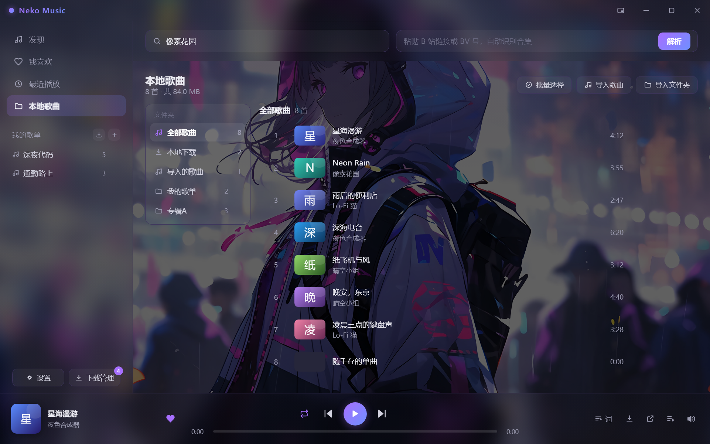
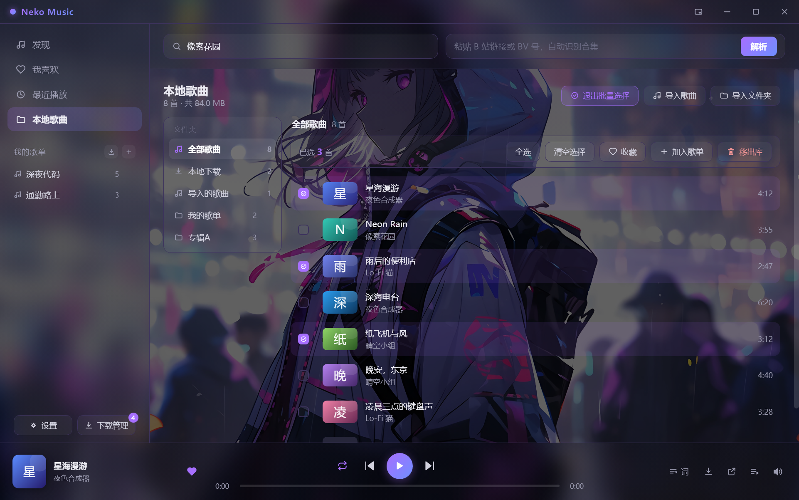
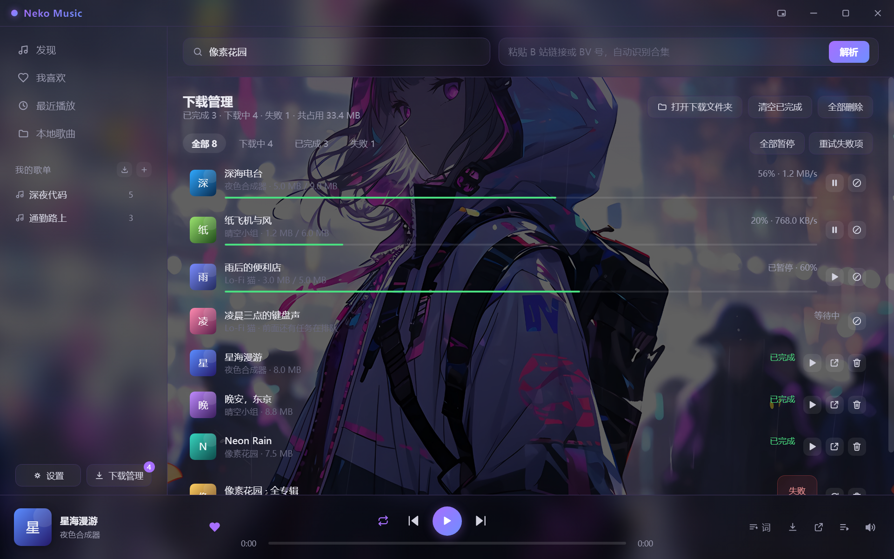
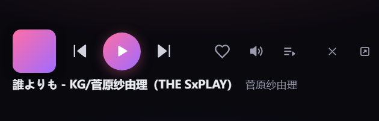
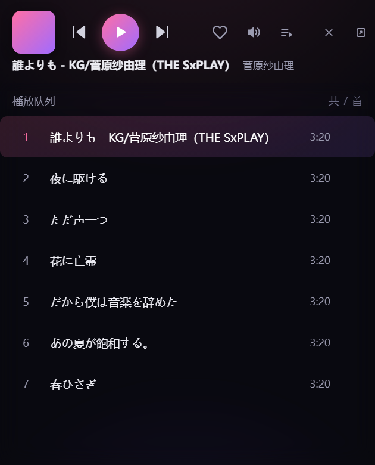
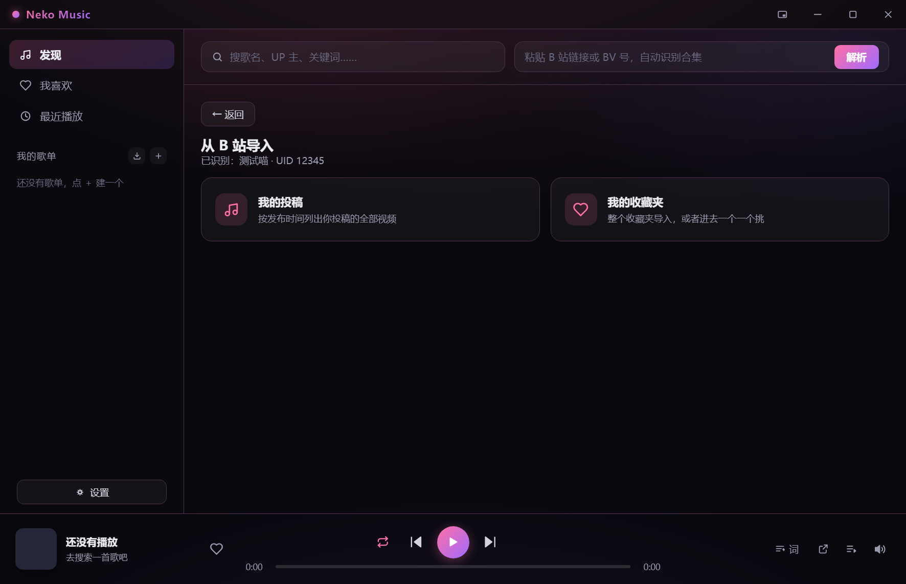
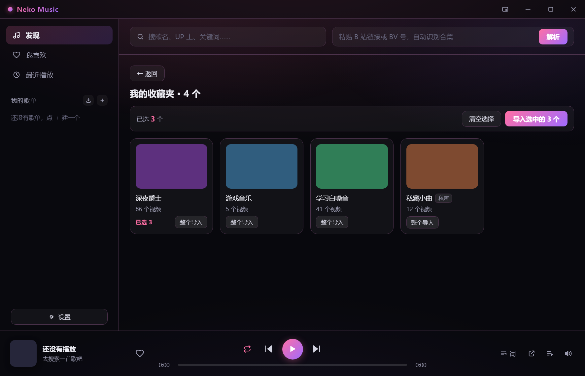
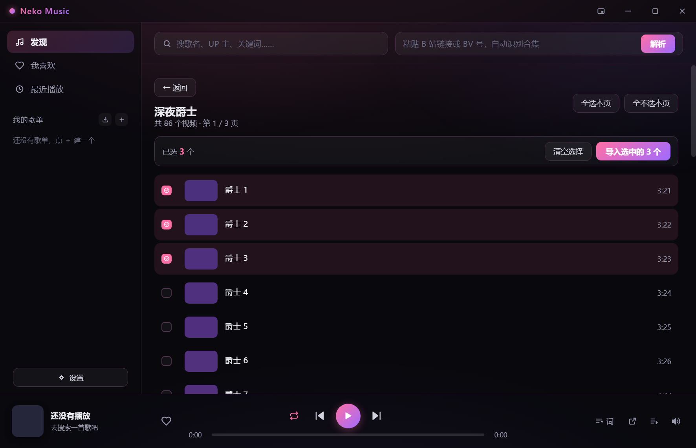
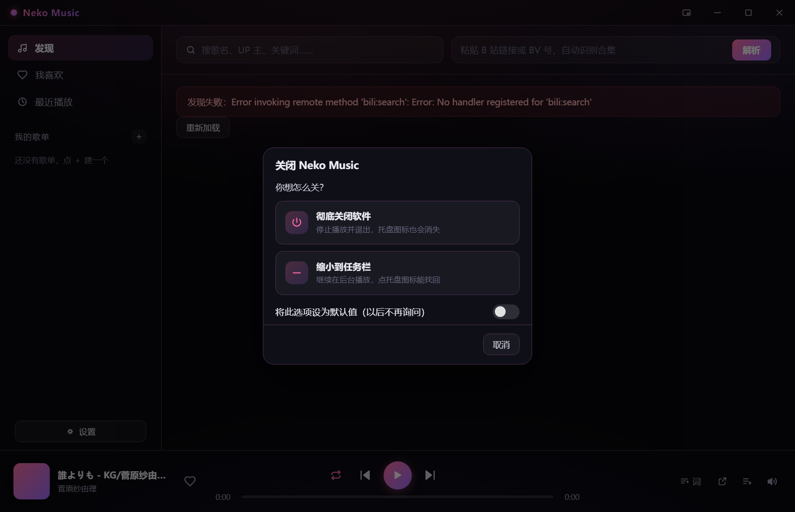
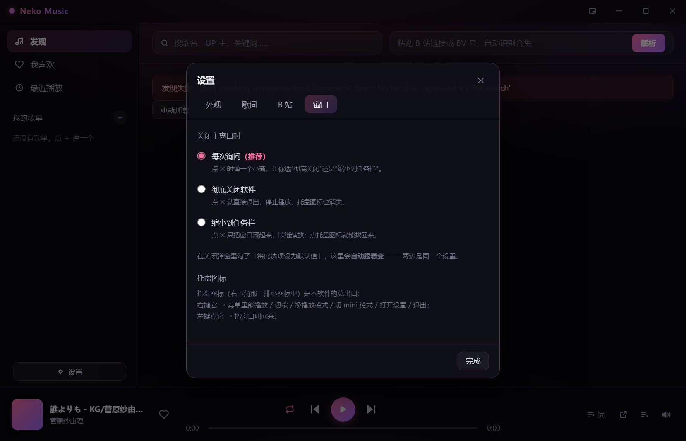

<div align="center">

# 🎧 Neko Music

**用 B 站当曲库的桌面音乐播放器**

把 B 站视频里的音频在线播放出来 —— 搜歌、合集、歌单、收藏、歌词、动态背景，一个不少。


</div>

> [!IMPORTANT]
> **免责声明**
>
> 本项目是**个人学习 Electron 与网络编程**的练习作品，与哔哩哔哩官方**没有任何关系**，也未获其授权或认可。
> 它只播放 B 站上**公开视频的音频流**，**不下载、不存储、不传播**任何内容，也不提供绕过登录或付费限制的能力。
> 请尊重内容创作者的版权，不要用于商业用途或大规模抓取。你播放的内容版权归 B 站及原 UP 主所有。
> 第三方接口随时可能变更，因此**不保证长期可用**（软件按"现状"提供）。

---

## 目录

- [✨ 功能](#功能)
- [📸 界面预览](#界面预览)
- [📥 下载与安装](#下载与安装)
- [🚀 快速上手](#快速上手)
- [⌨️ 快捷键](#快捷键)
- [❓ 常见问题](#常见问题)
- [🔄 更新日志](#更新日志)
- [🛠 它是怎么工作的](#它是怎么工作的)
- [🧱 从源码构建](#从源码构建)
- [📄 许可证](#许可证)
- [🙏 致谢](#致谢)

---

## 功能

- 🎵 **B 站即曲库** —— 搜歌名 / UP 主 / 关键词，或者直接把 BV 号、视频链接、短链（`b23.tv/xxx`）粘进右边的框点「解析」
- 👤 **点作者名看他全部视频** —— 结果列表里点 UP 主的名字，就进他的主页按发布时间列出全部投稿：**先问总数、再按 30 一条分页**，底部一条页码想跳第几页点第几页（页数多时页码会自动省略成 `1 … 3 4 5 6 7 … 28`），副标题写明「共 N 个视频 · 第 x / y 页」；翻页是**整段替换**（列表里永远只有当前这页），右上角「播放本页 (30)」也只把当前这页塞进队列
- 📚 **合集自动摊开** —— 遇到「130 首歌曲合集」这种七八个小时的长视频，点一下「选集 N」就拆成一集一集来听，**还能单独关掉不想听的那几集**
- ♡ **收藏 · 自建歌单 · 播放历史** —— 数据全部存在你自己电脑上，关掉再开还在；也能一键导入某位 UP 的公开收藏夹
- ⬇️ **导入自己的 B 站收藏夹** —— 侧栏「我的歌单」旁边的 ⬇ 按钮：先**认出你是谁**（显示昵称 + UID），然后列你自己的收藏夹（**连私密收藏夹都看得到**）。可以整个收藏夹一键导入，也可以进去一个一个挑；**挑的时候能跨收藏夹累积** —— 在 A 里挑 3 个、回列表、进 B 再挑 2 个，最后一起落成**一个**歌单（同一个视频只会算一次）。不填 Cookie 会直接给引导，不会白跑请求
- 💾 **下载到本地** —— 四个地方都能把歌存到电脑上：歌曲行右边的 ↓ 图标、播放条上的 ↓ 按钮、歌单 / 我喜欢的**批量下载**、合集选集每行 + 工具条。侧栏「下载管理」页能看每条任务的进度 / 速度 / 剩余，**暂停 / 继续 / 重试 / 取消 / 删除**，还支持**断点续传**（中途关软件再开接着下）；下好的歌按钮**变成绿色小勾**，点一下打开文件所在文件夹。音频**原样存 `.m4a`、不转码**
- 📁 **本地歌曲** —— 侧栏「本地歌曲」页把电脑里已有的音频（`.m4a` / `.mp3` / `.flac` / `.wav` / `.ogg` / `.aac` / `.opus`）导进来一起播：**只登记路径、绝不动你的文件**，认文件名里的「歌手 - 歌名」，本地歌也能收藏 / 进队列 / 在「正在播放」里高亮。文件被挪走 / 删掉了会标成「文件不见了」而不是删记录，顶部给黄条 + 「清理失效项」；**再点绿勾时发现文件其实不在，会当场变回可下载让你重下**
- 🗂 **本地歌曲分文件夹看 + 批量选择** —— 左栏列出「全部歌曲 / 本地下载 / 每个导入的文件夹 / 导入的歌曲」（带数量，点一下只看那组，文件夹行右边 ✕ 可整组移出库、只删记录不删文件）；右上角「批量选择」可一次 收藏 / 加入歌单 / 移出库
- 📝 **歌词两种看法** —— 桌面悬浮歌词（浮在所有软件最上面，最小化也照样跟着唱）+ 整页歌词（逐句滚动、点哪句跳哪句）
- 🗂 **播放队列抽屉** —— 点播放条上的「播放队列」，从右侧拉出「接下来播什么」的列表：能直接跳播、把某首移出去、清空，还能在队列里搜索过滤
- 🔁 **四种播放模式** —— 列表循环（默认）/ 单曲循环 / 随机播放 / 顺序播放，点播放条上的按钮循环切换，图标一眼看出当前是哪种
- 🖼 **动态背景** —— 用图片或视频当壁纸，配「压暗 / 模糊 / 毛玻璃 / 透明度」四根滑杆；视频背景还有专门的**省显卡**开关
- 🎨 **五套主题色 + 无边框界面** —— 自绘标题栏、统一单色 SVG 图标、磨砂半透明面板，切换主题只换点缀色、绝不跟你的壁纸打架
- 🪟 **mini 模式** —— 点标题栏最左边那个按钮（或按 `Ctrl+M`），窗口缩成**一条 420×132 的小窗**：封面 + 上下首 / 播放 + 收藏 / 音量 / 队列 + 关闭 / 还原，下面一行歌名。它会像桌面歌词一样**浮在所有窗口最上面**（别的软件全屏也压得住），歌名再长也不会把右边那排图标挤出窗口；再点 ☰ 会**往下长出一块播放队列**（正在播的那首高亮、点一行直接跳播）；点 ▢ 退出时**回到进 mini 之前的位置和大小**
- 📌 **托盘图标 + 右键菜单** —— 窗口右下角托盘区常驻一个**猫耳音符**图标：右键能出**一整套遥控菜单**（显示主窗口 / 当前歌名 / 暂停·上下首 / 播放模式 / 窗口模式 / 桌面歌词开关 / 设置 / 退出），播放模式和窗口模式是**带打勾的子菜单**，歌名和播放状态一变菜单就跟着变；左键点一下图标窗口就回来
- 🖱️ **任务栏缩略图按钮** —— 鼠标悬停任务栏上的软件图标，弹出的预览里带 **⏮ ▶ ⏭ 三个按钮**（播放/暂停同一个按钮换图标）；进 mini 模式后，那块预览还会**自动裁到专辑封面那一块**
- 📋 **任务栏右键「任务」** —— 右键任务栏图标，能看到「暂停/播放」「上一首」「下一首」「mini 模式」「设置」几个快捷项（Windows 对这里的子菜单有限制，所以播放模式那类多层菜单挂在**托盘**上）
- ❓ **点 ✕ 先问一句** —— 第一次点关闭会弹一个自绘的小窗：「**彻底关闭软件**」还是「**缩小到任务栏**」，底下有「将此选项设为默认值」。勾上以后就不再问；在 **设置 → 窗口** 里随时能改回来
- 🔒 **只开一个窗口** —— 不小心双击了两次软件图标，也只会有一个窗口（第二次会把已有窗口叫到前面），不会开出两个抢同一份歌单

## 界面预览

> 下面几张都是**实机截图**。最上面那张大图是 **发现页**（启动默认停在这里）—— 用 B 站「歌曲」「音乐」两个关键词搜索、去重后随机挑 8~10 个视频推荐给你，点「随机换一批」重新抽。
> 界面长什么样取决于你选了什么背景 —— 这几张统一用同一张壁纸截的，方便对照。
> 歌名 / UP 主 / 收藏夹 / 文件路径**全部是虚构的演示数据**，不掺任何真实信息。

### 本地歌曲（分文件夹 + 批量选择）



**左栏**按「来源」分组：**全部歌曲** / **本地下载** / 每个导入的文件夹 / **导入的歌曲**，每组带数量，点一下只看那一组。
**右栏**是这一组的歌，右上角「批量选择」。



点「批量选择」进入勾选态：**点整行就能勾**（热区大），顶部工具条实时显示已选多少首，
可以 **全选 / 清空选择**，再一次性 **收藏 / 加入歌单 / 移出库**。
**全选只作用于当前分组**，换分组或离开这一页会自动退出勾选 —— 不会带着一屏勾选框跑到别处。

### 下载管理



每条任务一行：**正在下**的显示进度条 + 百分比 + 实时速度，**已暂停**显示停在哪，
**已完成**的可直接播放 / 打开所在位置，**失败**的写明原因并可重试。
顶部一行统计「已完成 · 下载中 · 失败 · 共占用」，四个标签（全部 / 下载中 / 已完成 / 失败）按状态筛；
还有「全部暂停」「重试失败项」「清空已完成」「全部删除」。

### 合集「选集」面板


长视频 / 合集一键摊开成曲目表：每集可单独 **✅ 听 / 🚫 不听**，顶部有「全部启用 / 全部禁用」，
副标题实时显示「已启用 12/12 集」，还能直接在面板里搜索过滤。

### 整页歌词


点播放条最左边那张封面展开（再点一次收起）。当前句高亮放大、**始终停在屏幕正中间**，整块跟着播放逐句滚动；**点某一句就跳到那句的时间**。

### mini 模式





**收起态**（左图，420×132）就是一条小窗：封面在左、⏮⏸⏭ 在中、♡ 🔊 ☰ 在右、✕ ▢ 贴最右角，歌名单独一行（太长自动省略号）。**整条都能拖着走**（没有标题栏了，这一条就是窗口把手）。
**展开态**（右图，420×520）点 ☰ 往下长出来：列表就是**当前播放队列**，正在播的那首高亮；点任意一行直接跳播，点右边的垃圾桶把它移出队列。再点一次 ☰ 收回去。

### 外观设置（动态背景）


主题色、动态背景（图片 / 视频）、压暗 / 模糊 / 毛玻璃 / 透明度，以及动态背景专属的省显卡开关。

### 导入自己的 B 站收藏夹



侧栏「我的歌单」旁边的 ⬇ 按钮进来的整页。第一屏先**认出你是谁**（昵称 + UID），再选来源。



收藏夹列表：右下角「整个导入」一键整夹选中，卡片上的「已选 3」是**跨收藏夹累积**的角标（私密收藏夹带「私密」小标；最后一张「很久没听」是 B 站没给封面的，显示一个音符占位）。



挑视频：点整行就能勾（热区大），勾上的行整行泛粉；顶部一直挂着「已选 N 个」，翻页、换收藏夹都不丢。

### 关闭时的小弹窗 + 设置「窗口」页



第一次点标题栏右上角那个 **⏻**（电源键）时弹出的小窗：两个大按钮任选一个，底下勾「将此选项设为默认值」下次就不再问。
之所以画成电源键而不是 ✕，是因为这个 ✕ 在标题栏里已经代表"关闭窗口"了，含义容易撞车。



同一件事也能在 **设置 → 窗口** 里改：三选一（每次询问 / 彻底关闭 / 缩小到托盘），改完立刻生效。
这一页也解释了**托盘图标**是干什么的（它在屏幕右下角，窗口关掉后还能靠它把窗口叫回来）。

## 下载与安装

**① 直接装（最省事）** —— 去 [Releases](https://github.com/xingkinglb/neko-music/releases/latest) 页
下载 **`NekoMusic.Setup.<版本号>.exe`**（约 82 MB），双击一路下一步就行。
装完开始菜单和桌面都有快捷方式，卸载也在「设置 → 应用」里正常走。

> 首次启动若被 Windows SmartScreen 拦了一次，点「仍要运行」即可 ——
> 安装包没有做代码签名（签名证书要花钱），这是自建 Electron 应用的正常现象。

**② 用源码跑起来** —— 想改代码、追新提交的话走这条路，见下面的 [快速上手](#快速上手)。

**③ 自己打一个安装包** —— 见 [从源码构建](#从源码构建) 里的 `npm run build`。

## 快速上手

### 第 1 步：确认电脑有 Node.js

打开 PowerShell（按 `Win + R`，输入 `powershell` 回车），输入：

```powershell
node -v
```

显示 `v18.x` 或更高就 OK。如果提示"不是内部或外部命令"，去 <https://nodejs.org> 下载 LTS 版安装，一路下一步即可。

### 第 2 步：装依赖

```powershell
git clone https://github.com/xingkinglb/neko-music.git
cd neko-music
npm install
```

（`node_modules` 有好几百 MB，所以没有放进仓库。）

### 第 3 步：双击启动

**双击 `启动播放器.vbs`**，软件窗口就出来了 🎉 干净利落，不会多出任何黑窗口。

出问题时改双击 **`调试启动.bat`** —— 它会**故意**保留黑窗口，把运行日志和网页报错全部显示出来。
软件打不开、播放没声音的时候用它，把黑窗口里的内容截图发出来就行。平时不需要。

<details>
<summary>为什么启动文件是 <code>.vbs</code> 而不是 <code>.bat</code>？（值得一读的小坑）</summary>

`.bat` 一运行，Windows 就会开一个黑色的命令行窗口。而 `electron.exe` 是"图形程序"，
它会**继承**这个窗口 —— 等 bat 自己退出后，那个黑窗口还被 electron 拽着不放，
于是就成了一个关不掉的日志窗口，还不停往里刷消息。

`.vbs` 由 `wscript` 执行，而 `wscript` **天生没有控制台**，它启动的程序自然干干净净。
原理就一句：**让"没有控制台的东西"去启动它。**

**为什么不用 `npm start`？** 因为 `npm` / `npx` 依赖系统 PATH 里能找到 Node.js，
不同电脑配置不一样，很容易失败。而启动器直接调用 `node_modules\electron\dist\electron.exe` ——
**Electron 自带运行时**，是个独立程序，跟你装没装 Node.js 完全无关。

</details>

## 快捷键

| 按键 | 作用 |
|---|---|
| `空格` | 播放 / 暂停 |
| `Ctrl + ←` / `Ctrl + →` | 上一首 / 下一首 |
| `←` / `→` | 快退 / 快进 5 秒 |
| `↑` / `↓` | 音量 ±5 |
| `Ctrl + L` | 开 / 关**桌面歌词**（悬浮窗） |
| `Ctrl + D` | 开 / 关**整页歌词** |
| `Ctrl + M` | 进 / 出 **mini 模式**（缩成一条小窗） |
| `Esc` | 收起整页歌词 / 关闭设置面板 |
| `F11` | 全屏 |

> 音量还有两个不用记的操作：**点喇叭图标 = 静音 / 取消静音**，**在音量那一块上滚滚轮 = 调音量**。
> 平时播放条右侧只显示一个喇叭图标，鼠标移上去才会向上浮出竖向滑杆。
>
> 💡 光标在搜索框里打字时，以上快捷键全部自动让位，不会乱触发。

## 常见问题

### 怎么用起来

<details>
<summary><b>播放没声音？</b></summary>

先检查右下角系统音量，再把鼠标移到播放器右下角的**喇叭图标**上，把浮出来的竖条拉到中间以上
（点一下喇叭图标是静音开关，别是静音状态）。如果还是不行，双击 `调试启动.bat` 启动它，
窗口里会显示出错原因。

</details>

<details>
<summary><b>提示"音频加载失败了，可能链接已过期"？</b></summary>

B 站的音频地址有时效（几小时）。重新点一下这首歌就好。

</details>

<details>
<summary><b>搜索成功但点播放没反应？</b></summary>

某些视频是会员专属或有版权限制，拿不到音频流。换一首试试。

</details>

<details>
<summary><b>双击 <code>启动播放器.vbs</code> 没有任何反应？</b></summary>

按这个顺序排查：

1. 先试 **双击 `调试启动.bat`** —— 它会把错误直接打出来，截图发出来最快
2. 确认 `node_modules\electron\dist\electron.exe` 这个文件存在（应该有 188 MB 左右）
3. 打开终端（地址栏输入 `cmd` 回车），运行 `node_modules\electron\dist\electron.exe .`，把红色报错发出来

> 万一双击 `.vbs` 被系统或杀毒软件拦了，就用 `调试启动.bat` 代替，功能完全一样，
> 只是会多一个黑窗口（那个窗口是故意的，关掉软件它自己会消失）。

</details>

<details>
<summary><b>明明没开别的程序，却多了一个黑窗口不停刷字？</b></summary>

那是 **`.bat` 启动方式**的特征 —— electron 会继承 bat 的控制台，bat 退出后窗口被它拽着不放。
改用 `启动播放器.vbs` 就没有了。

</details>

### 搜索 / 限流

<details>
<summary><b>搜索时好时坏，或者干脆搜不出来？（B 站限流）</b></summary>

B 站对未登录的请求有**随机限流**。填一个 Cookie 就能稳定非常多：

1. 浏览器打开 <https://www.bilibili.com> 并登录
2. 按 `F12` → 点顶部「Application」（中文版叫「应用程序」）
3. 左侧找 `Cookies` → `https://www.bilibili.com`
4. 找到名字是 **`SESSDATA`** 的那一行，复制它的值
5. 回到播放器，点左下角 **⚙ 设置**，切到「B 站」标签页，把 SESSDATA 粘进去

**不填也能用，只是偶尔需要多点两次。**

> 填的时候，浏览器开发者工具里复制 **Cookie Value** 那一列的内容即可，**不用**自己加 `SESSDATA=` 前缀。

</details>

<details>
<summary><b>歌词取不到 / 取到别的视频的歌词？</b></summary>

取字幕需要先填 Cookie（见上一条）。没填的话点了「词」会提示你去填 —— 这是正常的，不是坏了。

B 站曾经把旧的字幕接口 `/x/player/v2` **悄悄降级**：它不报错，而是随机返回**别的视频**的字幕，
而且返回码还是"成功"。现在改走 B 站网页播放器真正在用的那条接口（带 WBI 签名），
另外还有三重兜底：核对 `cid`、识别诱饵内容、失败自动重试 3 次；万一对不上，
歌词顶部会显示橙色提示条告诉你。

有些句子被字幕本身切碎时，软件现在只会在**唱歌置信度高、时间轴可靠、合并后仍较短**的情况下自动并回去。
如果时间轴无法判断句界，就保持字幕原样；因此不是每一首都能修正分段。

真的遇到取不到时，多数是**没填 Cookie** 或**这个视频确实没有字幕**，界面上会分别说明原因。
也可以点播放条上的 **↗ 打开视频** 去 B 站网页版直接看字幕。

</details>

### 背景 / 界面

<details>
<summary><b>选了背景图却不显示 / 显示裂图？</b></summary>

背景走 `bg://` 私有协议读取，文件存在 `%APPDATA%\neko-music\backgrounds\`。排查：

1. 确认图片是 **png / jpg / webp / gif / bmp**
2. 双击 `调试启动.bat` 看有没有红色报错
3. 点「清除背景」再重新选一次

</details>

<details>
<summary><b>动态背景（视频）选了不播 / 一片黑？</b></summary>

1. 确认格式是 **mp4 / webm / mov**（AVI、MKV 等不保证能播，选了会提示）
2. 确认大小 **≤ 200MB**（超了会提示换小的）
3. 视频默认是**静音 + 循环**的，如果你觉得"没声音"——那是正常的，静音开关在设置里
4. 窗口最小化、切到别的软件、或者**打开设置面板**时，视频会**自动暂停**（省电），回到前台才会接着播
5. 素材分辨率太大（宽 > 1920）会提示你换小的，**压到 720p / 30fps 最省显卡**

</details>

<details>
<summary><b>开了动态背景，显卡占用有点高？</b></summary>

打开 **设置 → 外观 → 「降低毛玻璃（省显卡）」**（默认就是开的）。
它会在动态背景时关掉四块常驻面板的实时模糊 —— 那是最吃显卡的地方。
另外把素材压到 720p / 24~30fps 收益也很明显。

</details>

<details>
<summary><b>封面是空白的？</b></summary>

已经修好了。原因是 B 站返回的封面地址是 http，被页面的安全策略拦下。如果你看到的是老版本，重启一下软件即可。

</details>

<details>
<summary><b>软件打不开 / 白屏？</b></summary>

双击 `调试启动.bat`，看黑窗口里打印的报错信息 —— 那里会有明确的原因。

</details>

### 数据安全

<details>
<summary><b>改代码改坏了，歌单收藏会不会丢？</b></summary>

不会，你的数据在**另一个地方**，跟代码完全分开：

```
C:\Users\<你的用户名>\AppData\Roaming\neko-music\neko-data.json
```

怎么手动备份：按 `Win + R`，输入 `%APPDATA%\neko-music` 回车，把 `neko-data.json` 复制一份到桌面就行。

万一真丢了数据，把备份文件改回 `neko-data.json` 放回原目录，重启软件即可恢复。

</details>

<details>
<summary><b>我的歌单、Cookie、壁纸会被上传吗？</b></summary>

不会。用户记忆（歌单 / 收藏 / 历史 / 设置）、B 站 Cookie、自定义背景**全部只存在本机 `%APPDATA%\neko-music\`**，
不在项目目录里，也**不会随 Git 上传** —— `.gitignore` 里另有保险条目兜底。
仓库里分享的代码不包含任何私人存档；换电脑时请自行备份该目录。

</details>

## 更新日志

### 最近更新（v2.8.1）

「本地歌曲」页做了一次体验补充 —— 歌一多，平铺一长条就不好找了。

- 📂 **左栏加了文件夹列表**：**全部歌曲** / **本地下载** / **每个导入的文件夹**（有几个导入几个）/ **导入的歌曲**。每组带数量，**点一下只看这一组**，再点「全部歌曲」回到全部
- ✕ **文件夹右边可单独移除**：鼠标移上去出现的 ✕，点一下把这**一整个文件夹的记录**从本地库移除 —— 会先问一次，并写明「磁盘上的文件不会被删」
- ☑️ **右上角「批量选择」**：进去后每行带小方框，顶部工具条 **已选 N 首 · 全选 · 清空选择 · 收藏 · 加入歌单 · 移出库**；**全选 / 清空只作用于当前文件夹分组**，换文件夹或切页面会**自动退出**勾选，不会带着一屏勾选框跑到别处
- 🏷 **分组是按"你导入时选的根目录"分的**，不从路径反推 —— 多级子目录、或两个同名文件夹都不会分错；老用户升级后原来的本地歌归到「导入的歌曲」一组，**一条记录都不丢**
- ✅ 静态自检 **59 大类**通过（新增第 59 类，专盯分组 / 批量选择 / "只删记录不删文件"的反向断言）；**判别力实测 52/52 会响、还原后全绿**；离线新测试 `test-round21`（12 组）全过；**全量回归 24 个脚本全绿**

<details>
<summary>上一个版本（v2.8.0）改了什么</summary>

这一版给软件加了**下载**：喜欢的歌能存到电脑上离线听；再开一个「本地歌曲」页，把你电脑里已有的音频导进来一起播。

- ⬇️ **四个地方都能下**：歌曲行右边的 ↓ 图标、播放条「词」旁边的 ↓ 按钮、歌单 / 我喜欢的**批量下载**、合集选集每行 + 工具条。下好的歌按钮**变成绿色小勾**，点一下打开文件所在文件夹
- 📥 **「下载管理」页**：每条任务的进度 / 速度 / 剩余，能暂停 / 继续 / 重试 / 取消 / 删除；**断点续传**——中途关软件再开接着下。设置页新增「下载」分页（下载目录、同时下几首 1~4、几个开关）
- 📁 **「本地歌曲」页**：「导入歌曲 / 导入文件夹」把电脑里已有的 `.m4a` / `.mp3` / `.flac` / `.wav` / `.ogg` / `.aac` / `.opus` 加进来。**只登记路径、绝不动你的文件**；认文件名里的「歌手 - 歌名」；本地歌也能收藏、进队列、在「正在播放」里高亮
- 🩹 **文件被挪走 / 删了也不会坏**：软件会做「失联体检」，把找不到源文件的条目标成「文件不见了」（**不删记录**），页面顶部给黄条 + 「清理失效项」。**再点那个绿勾时如果文件其实已经不在，会当场变回「可下载」让你重下**——不会再「绿勾还在、点下去没反应」
- 🔊 **播放卡顿 / 卡死能自愈**：以前播到一半偶尔一卡一卡、最后彻底卡死，拖条重播都卡在同一个地方。现在音频「卡住 / 等待」时会**自动重新解析播放地址、把进度接回原处继续播**；地址快过期也会提前刷新
- 📼 **原样存、不转码**：音频照原样存 `.m4a`（不转码、不内置 ffmpeg，安装包不变大）；封面单独存应用数据目录
- ✅ 静态自检 **58 大类**通过（新增第 56 / 57 / 58 类）；**判别力实测 37/37 会响、还原后全绿**；离线新测试 `test-round18`（下载引擎）/ `test-round19`（`local://` 白名单）/ `test-round20`（本地库）**全部通过**；**全量回归 23 个脚本全绿**（顺带修掉一个批次 A 引入的 mini 布局回归——新下载按钮没在 mini 下收起，把「✕ ▢」挤到了第二行）；图标体检 **38 项**、README 检查通过

</details>

有些歌词字幕把一句话切成几截。这一版会在**证据足够时**把相邻的短碎句并回来；拿不准就保持原样，不会为了连句把歌词乱粘：

- 🎵 **歌唱置信度高**才处理，口播 / vlog 字幕不碰
- ⏱ **整条时间轴大多数地方确实有停顿**才处理；时间轴铺满、无法判断句界的字幕保持原样
- ✂️ 只合并**没有停顿**且合并后不超过 15 字的短片段；长句不跨句粘连
- 🖥 整页歌词与桌面歌词使用同一份结果，会一起改善；不联网、不新增设置项
- ✅ 真实字幕 9 首实测：花海 49→44 行，5 次合并；另外 8 首保持原样。离线新测试**在改前代码上实际失败 5 项**，改完全过；静态自检 **55 大类**通过；回归 round13 / round14 / round15 / round16 / ui / collect / keys **全部通过**
- 📌 这不是所有字幕的通用修复：B 站有些字幕时间轴本身没有句界信息，软件会安全地不改。第三方 LRC 方案已归档到施工图第九节，暂不开发

</details>

<details>
<summary>更早（v2.6.1）改了什么</summary>

上一版的「导入我的 B 站收藏夹」里，**收藏夹卡片一个封面都没有**，全是空色块 —— 这一版修好了：

- 🖼 **收藏夹封面回来了**：你的 69 个收藏夹，实测 **59 个**能正常显示封面
- 🎵 **B 站自己没给封面的（实测 10 个）显示一个淡淡的音符**，不再是一块什么都没有的深色方块 —— 一眼能分清是"本来就没有"还是"没加载出来"
- 🔍 **原因不是样式，是接口选错了**：原来用的 `/folder/created/list-all` 返回里**根本不带 `cover` 字段**，换成分页版 `/folder/created/list` 才有（实测 0/69 → 59/69）。同一个问题在「点作者名 → 看他的公开收藏夹」那一屏也一起修好了
- 📦 **顺手给安装包瘦了 36 MB**：以前打包没设白名单，`.tmp/`（61MB）、`.verify/`（100 个开发期脚本）、`docs/`（截图）、甚至**项目笔记**全被打进了 `app.asar`。加了白名单后 **119.6 MB → 81.8 MB（省 31.6%）**，功能一个没少（旧包 313 项 vs 新包 53 项逐条比对过，被排除的里面没有一条 `src/`）
- ✅ 静态自检 **54 大类全过**（新增第 53 类 13 条，含反向断言"不许退回 `list-all`"；第 54 类守打包白名单）；**新写 `test-round16.js`（8 组：打桩 `https` 直验"请求打的是哪个接口" + 离屏真点验封面与占位）**；把源码回退到 v2.6.0 时该组报 **11 处失败**

</details>

<details>
<summary>更早（v2.6.0）改了什么</summary>

侧栏「我的歌单」那一行、＋ 左边多了一个 **⬇ 按钮** —— 点进去可以**把自己 B 站的收藏夹搬进来**，整夹导入或者一个一个挑：

- 🔎 **先认出你是谁**：进来先显示你的昵称 + UID，然后给「我的投稿」「我的收藏夹」两张来源卡。列的是**你自己的**收藏夹，**连私密收藏夹都看得到**（那是本人登录才看得见的）
- ⬇️ **整夹一键导入**：收藏夹卡片右下角一个「整个导入」，点一下把这个收藏夹的**全部**视频加进"已选"，不用一页页翻
- ☑️ **挑视频：点整行就能勾**（热区大），勾上的行整行泛粉；右边那排「收藏 / 加歌单 / 详情」在挑歌时**藏起来**（它们是干扰，还会抢走点击）。右上角有「全选本页 / 全不选本页」，底下是页码条
- ★★ **挑的时候能跨收藏夹累积**：在收藏夹 A 里挑 3 个 → 回列表 → 进收藏夹 B 再挑 2 个 → **最后一起导入成一个歌单**。翻页、换收藏夹、点返回**都不会清空**已选；**同一个视频出现在两个收藏夹里只算一次**（拿视频号去重，所以进 B 看到它时它已经是勾上的）
- 📛 **卡片上有「已选 3」角标**，一眼看出每个收藏夹挑了几个；顶部一直挂着「已选 N 个 · 清空选择 · 导入选中的 N 个」，**已选 0 个时「导入」自动置灰**
- ✏️ **起名字**：点导入会弹输入框，**默认名就是收藏夹名**（跨收藏夹挑是「我的收藏」，我的投稿是「我的投稿」）；确定后建歌单并**跳到新歌单**
- 🚧 **没填 Cookie 不会白跑**：页面上直接给引导「去左下角『设置 → B 站』填一下 Cookie」，**而且不会去发请求**；Cookie 过期（B 站回 `-101`）会明确说「好像过期了，重新粘一次」，而不是丢个看不懂的报错
- ✅ 静态自检 **52 大类全过**（新增第 52 类 33 条，含"选择集必须是 Map""返回不许清空选择""只有 2 处能清空"这类**反向断言**）；**新写 `test-round15.js`（14 组，离屏真点：跨收藏夹累积到 5 个、翻页不丢选择、重复视频只算一次、整夹导入 86 再取消、命名框默认名 + 建歌单 + 跳转 + 写盘）**；回归 round13 / round14 / ui / keys / collect / README / 图标体检 **全过**

</details>

<details>
<summary>更早（v2.5.0）改了什么</summary>

作者主页的翻页**整个重做了**。你反馈「默认只给 30 条、要看更多得一直点右上角的『加载更多』，体验很不好」—— 这一版照着你画的样子改成了**真正的分页**：

- 📄 **先问总数，再按 30 切页**：进页面先拿 B 站给的**总投稿数**，然后按 30 一条分页。副标题直接写明「**共 137 个视频 · 第 1 / 5 页**」。`加载更多` 这个模型本身就没有"我在第几页"的概念，光改按钮没用 —— 必须先把总数带回来
- 🔢 **底部分页条，想跳第几页点第几页**：`[← 上一页] [1] [2] [3] [4] [5] [下一页 →]`，当前页**实心高亮**；第 1 页的「上一页」、最后一页的「下一页」**自动置灰**
- ✂️ **页数多时页码自动省略**：只留「首 + 当前页前后各 2 + 尾」。共 28 页时，第 1 页是 `1 2 3 … 28`，第 5 页是 `1 … 3 4 5 6 7 … 28`；**只有 5 页就全列出来**，不省略
- 🔁 **翻页是「替换」不是「累加」**：翻到第 2 页，列表里就**只有**第 2 页那 30 条（视频 31~60），第 1 页的**消失**——不是堆成 60 条。实测专门量了这条（60 行就是错的）
- ▶️ **「播放全部」改名「播放本页 (30)」**：以前叫"全部"会让人以为要播 137 个。现在括号里的数字跟着当前页实际条数走（满页 30、最后一页 17），点它 = 只把**你眼前这一页**塞进队列
- 🙈 **只有 1 页时不画分页条**（比如只投了 2 个视频的 UP），界面干净
- ✅ 静态自检 **51 大类全过**（新增 G 段 8 条，含反向断言：「加载更多」不许复活、`loadUp` 不许变回累加）；**新写 `test-round14.js`（7 组，真跑界面代码：137→5 页、837→28 页、页码省略、边界置灰、队列正好 30 首）**；回归 round13 / ui / keys / collect **全过**

</details>

<details>
<summary>更早一点（v2.4.0）改了什么</summary>

真机上试用后报的几个问题，**全部修好了**。三条都很具体，改动也都很小 —— 但每条都挖到了真正的根因：

- 📌 **mini 模式现在置顶了**：以前随便开个浏览器 / 文件夹窗口就能把它盖住，白做。现在它跟桌面歌词用**同一档置顶等级**（`screen-saver`，比普通置顶还高一级，别的软件全屏也压得住）。进 mini 立刻置顶、退出立刻取消、展开态也保持置顶；**存档就是 mini 时一开窗就带上置顶**，不会"启动后头一帧先被盖一下"
- 📐 **歌名太长不再把图标挤出窗口**：以前歌名一长，`♡ 🔊 ☰ ✕ ▢` 会一起往右跑、最后跑到窗口外面。根因是 `.np` 上的 `display: contents` 把它的 `min-width: 0` **连同约束一起抹掉了**，而 `.np-title` 是 `nowrap`，于是播放条被撑宽（实测 **50 字撑到 684 宽、100 字到 992 宽**，窗口只有 420）。现在给播放条补上 `min-width: 0`，并让**标题先让位、作者名后让位**；5 种歌名长度（6 / 27 / 43 / 50 / 100 字）实测图标全在窗口内、没有横向滚动
- 🧹 **合集面板删掉了「加入队列」**：它把搜索框挤得**只能显示一个字**，而**点行 / 点「播放全部」本来就会自动入队** —— 这按钮是多余的。删掉后位置全给搜索框，并给它设了下限（`min-width: 140px`），**以后按钮再多也不许把它挤成一个字**
- ✅ 静态自检 **51 大类全过**（含三条反向断言：删掉的按钮和死代码不许复活）；**新写 `test-round13.js`（真窗口 `isAlwaysOnTop()` + 5 种歌名长度量坐标）**；回归 round10 / round11 / round12 / collect / ui / keys **全过**

</details>

<details>
<summary>再往前（v2.3.0）改了什么</summary>

设置里多了一页**「快捷键」**—— 以前这个软件有 11 条快捷键（空格暂停、Ctrl+D 整页歌词、Ctrl+M 进 mini……），但**全部写死在代码里**，界面上一个字没提，也改不了。这次全部搬上台面：

- ⌨️ **12 条全列出来了**：设置 → 快捷键，每行一个功能 + 当前键位 + 一个 ↺（这条恢复默认），页底一个「全部恢复默认」。旧有的 11 条都保留了，还新增一条：**Ctrl + ,（逗号）打开设置**
- ✏️ **点一下就能改**：点中间那个键位框 → 框亮起来变成「按下新键…」→ 直接按新组合就改好了。按 **Esc** 或点框外面取消
- 💡 **提示跟着变**：鼠标悬停播放条封面 / 「词」按钮 / mini 按钮时，提示里的键位是**现拼的** —— 以前那几处写死了 `Ctrl+D`，键位一改提示就会说谎
- 🚧 **撞车会先问一句**：想绑一个**已经被别的功能用了**的键，会弹出来让你选「让出来 / 取消」，绝不悄悄改（两条绑同一个键，谁生效全看清单顺序，查起来要命）
- 🧯 **Esc 永远绑不走**（它是所有面板的逃生键）；**焦点在输入框里时快捷键一律让路**（搜索框里打空格不会变成暂停）—— 这两条老规矩这次写进了 51 类自检里
- 🧪 **修饰键必须"完全一致"才算命中**：以前靠"谁写在前面谁先命中"才没让 `Ctrl+←`（上一首）顺带触发 `←`（快退）；改成查表之后靠**严格比对**守住，离屏实测专门有一组各按三遍盯着计数
- 🐱 **窗口和托盘换成纯色小猫图标**：按你选的 **5 号「几何方块猫」**，窗口 / 任务栏 / Alt+Tab 与托盘用同一只纯粉色小猫（托盘图标含 16 / 32 / 48 / 256 四档，最后一档同时供 Windows 安装包图标使用）
- ✅ 静态自检 **51 大类全过**；**新写 `test-keys.js`（12 组，真派发键盘事件）**；图标体检 **37 项全过**；回归 playing / round8 / round9 / round11 / round12 / collect / overlay / lyric-drag / persist / play-interrupt / ui **全过**

</details>

<details>
<summary>再往前一点（v2.2.1）改了什么</summary>

真机上试用 v2.2.0 后报的四个问题，**全部修好**了（这一版没有新功能）：

- 🎨 **托盘菜单的图标不再是"粉色方块"**：生成图标那段的画图函数形参写错了，写盘的 16 个图标全变成了**纯色块**或**完全透明**（有的项前面干脆一片空白）。**我原来那张"接触表"预览图是对的** —— 它走的是另一条代码路径，所以光看图查不出来。现在新增 `.verify/check-icons.js`：**不看图，直接把写盘的 .png 解码回来数像素**。另外每个图标现在出 16×16 和 32×32 两档，125% / 150% 缩放下系统会挑清楚的那张
- 🖱️ **悬停任务栏图标有 ⏮ ▶ ⏭ 了**：除了图标本身是坏的（Windows 规定"一个图标空 → 整组按钮不显示"），更隐蔽的是**设按钮的时机** —— 原来在窗口显示出来之前就设了，Windows 会**一声不响地失败**。现在等窗口真的显示后再设，也会把这个 API 的返回值记下来
- ❓ **第一次点 ✕ 会弹窗了**：界面那个 ✕ 当时是**直接让主进程"存盘 + 关闭"**，把"询问 / 缩小到任务栏 / 彻底退出"那套判断**整段绕过**了。现在 ✕ 走"关闭窗口"这条路，判断就能接上
- 🖼️ **合集音乐播放条有封面了**：查了存档 —— 曲目表有 **32 个合集**，封面表却是 **0 条**（为了不让存档变大，存曲目表时故意剥掉了封面；封面表只在"重新拉一遍曲目表"时才写，缓存过的合集永远走不到）。现在哪首发现没封面就自己补一次：贴到播放条 + 记进存档 + 同合集的其它集一起补
- ✅ 静态自检 **50 大类全过**；**新写 `check-icons.js`（36 项）+ `test-round12.js`（14 组）**；回归 round11 / round10 / round9 / round8 全过

</details>

<details>
<summary>再上一个版本（v2.2.0）改了什么</summary>

- 📌 **托盘图标 + 一整套遥控菜单**：屏幕右下角常驻一个**猫耳音符**小图标（16/32 双尺寸 `.ico`，纯 Node 手搓）。右键出来 16 项菜单 —— 显示主窗口 / 当前歌名（灰显、不可点）/ ▶暂停·上下首 / **播放模式**（带打勾的子菜单）/ **窗口模式**（子菜单）/ 桌面歌词开关·锁定 / 设置 / 退出；**歌名、播放状态、播放模式、窗口模式一变，菜单整个重建**；左键点图标窗口就回来
- 🖱️ **任务栏缩略图按钮**：鼠标悬停任务栏上的软件图标，预览里多出 **⏮ ▶ ⏭ 三个按钮**（播放/暂停共用一个按钮换图标）；进 mini 后，那块预览还会**自动裁到专辑封面那一块**（封面在界面的什么位置由**界面自己量好**告诉主进程，改一次 CSS 也不会错位）
- 📋 **任务栏右键「任务」**：`app.setUserTasks` 提供「暂停/播放」「上一首」「下一首」「mini 模式」「设置」几项。**Windows 对这里的子菜单是硬限制**，所以带层级的那套菜单挂在托盘上
- ❓ **点 ✕ 先问一句**：第一次关闭弹自绘小窗 —— 「**彻底关闭软件**」/「**缩小到任务栏**」+「将此选项设为默认值」；勾过就不再问，**设置 → 窗口** 里随时能改回来。窗口真退时**照样走存盘握手**，绝不丢歌单
- 🔒 **单实例锁**：双击两次软件图标只开一个窗口；第二次会把已有窗口叫到前面（`restore → show → focus` 三步，最小化时也能正确还原）
- ✅ 顺手堵掉几个口子：拦掉页面里 `window.open` 开新窗口、未捕获异常改成"标记退出 + 正常退"（不再留后台残影）、退出时销毁托盘图标
- 🐛 **修掉三个真 bug**（都是实测抓出来的）：① **读存档把不认识的字段全丢了**（v2.1.0 埋下 —— `settings.window` / `playMode` / `lyricWin` **存得进读不出**，每次启动被抹成默认值）；② **第一次进 mini 时封面位置没传给主进程**（缩略图裁不了）；③ **关窗弹窗可能永久点不动 + 改了设置不生效**（去重缓存与主进程打架）
- ✅ 静态自检 **49 大类全过**；**新写 `test-round11.js`** 离屏实测（14 组 / 90+ 条断言，能跑真代码就绝不写桩），并回归 round10 / round9 / round8

</details>

<details>
<summary>再上一个版本（v2.1.0）改了什么</summary>

- 🪟 **mini 模式**：点标题栏最左边那个新按钮（或按 **Ctrl+M**），窗口缩成**一条 420×132 的小窗** —— 封面 + ⏮⏸⏭ + ♡🔊☰ + ✕▢，下面一行歌名。再点 ☰ 会**往下长出一块「播放队列」**（132 → 520 高），正在播的那首高亮、点一行直接跳播
- ↩️ **回到原处**：点 ▢ 退出 mini 时，窗口回到**进 mini 之前的位置和大小**；上次缩在 mini 里退出的，**下次打开还是 mini**
- 🖼️ **补上窗口图标**：任务栏 / Alt+Tab 里不再是 Electron 的默认灰图标，而是一个**猫耳 + 音符**的小图标（纯 Node 手搓 PNG 生成，没加任何依赖）
- 🔒 **自绘标题栏的三处加固**：拦掉 `Alt+Space` 冒出的 **Windows 系统菜单**、拦掉误按 **Ctrl+R 把界面重载回首页**、拦掉 **Chromium 默认右键菜单**（输入框里放行，不然没法粘贴 Cookie）

</details>

> 完整历史见 [CHANGELOG.md](CHANGELOG.md) ·
> 所有版本见 [Releases](https://github.com/xingkinglb/neko-music/releases)

## 它是怎么工作的

```
Music/
├── package.json          ← 项目说明书（叫什么名、要装哪些库）
├── 启动播放器.vbs         ← 双击启动（没有黑窗口）
├── 调试启动.bat           ← 出问题时双击它看日志
└── src/
    ├── main.js           ← 主进程（幕后老板，还负责托盘图标、任务栏按钮、开第二个歌词窗口）
    ├── preload.js        ← 传话筒（安全的沟通桥梁）
    ├── bilibili.js       ← 和 B 站对话的翻译官
    ├── bg-protocol.js    ← 背景壁纸专用的 bg:// 协议（含视频分段传输）
    ├── win-mini.js       ← mini 模式的窗口尺寸（收起 420×132 / 展开 420×520）
    ├── app-menus.js      ← 托盘菜单 / 任务栏任务 / 关窗行为 / 命令行参数（纯数据，好测）
    ├── store-migrate.js  ← 存档读写时的"补洞"（老存档缺字段就补默认值，不认识的字段原样留着）
    ├── assets/           ← 图标：app.png（窗口）+ tray.ico（托盘）+ menu-*.png（菜单小图标）+ thumb-*.png（缩略图按钮）
    └── ui/               ← 界面（骨架 index.html / 样式 style.css / 逻辑 app.js + 歌词窗）
```

**为什么分 `main` 和 `ui` 两个进程？** `ui/` 跑在"网页世界"，安全但没权限；
`main.js` 跑在"系统世界"，有权限但画不了界面；两个世界通过 `preload.js` 喊话。

三个最关键的技术点：**① wbi 签名**（B 站要求每个搜索请求带签名）、
**② `bili://` 协议**（`<audio>` 没法自定义请求头，于是自己造一个协议由主进程代发带 `Referer` 的请求）、
**③ 只取音频不下载视频**（B 站的 DASH 格式把音视频分开存，取纯音频只要几 MB）。

👉 想看详细的零基础讲解（含 `bg://` 协议、CSP 破图、动态背景的性能成因），见 **[docs/技术说明.md](docs/技术说明.md)**。

## 从源码构建

```powershell
npm install     # 装依赖（第一次要几分钟）
npm start       # 直接跑起来（等价于双击 启动播放器.vbs）
npm run build   # 打包成 Windows 安装包，产物在 dist/
```

> 第一次打包会下载额外工具，比较慢。如果卡在下载，说明网络不通，可以跳过这步 ——
> 用 `启动播放器.vbs` 已经足够日常使用了。

改完代码想自己验一遍？仓库里带了一套自检脚本（静态自检 + 8 套离屏实测），跑法见
[docs/技术说明.md 的「自检与实测体系」](docs/技术说明.md#自检与实测体系)。

## 许可证

[MIT](LICENSE) © 2026 Neo

## 致谢

- 灵感来自 [th-ch/youtube-music](https://github.com/th-ch/youtube-music) 等项目
- 动态背景的省电策略参考了开源动态壁纸 [Lively Wallpaper](https://github.com/rocksdanister/lively) 的官方性能文档
- 感谢所有把作品公开在 B 站上的 UP 主 🎧

<div align="center">

*Made with 💗 by Neko*

</div>
