<div align="center">

# 🎧 Neko Music

**用 B 站当曲库的桌面音乐播放器**

把 B 站视频里的音频在线播放出来 —— 搜歌、合集、歌单、收藏、歌词、动态背景，一个不少。


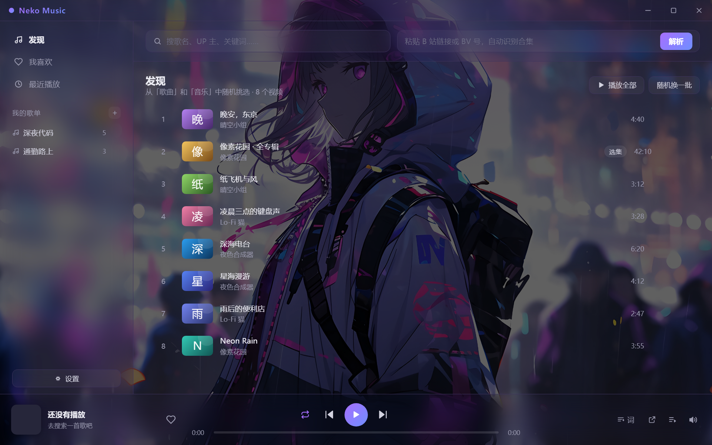

</div>

> [!IMPORTANT]
> **免责声明**
>
> 本项目是**个人学习 Electron 与网络编程**的练习作品，与哔哩哔哩官方**没有任何关系**，也未获其授权或认可。
> 它调用 B 站上**公开视频的音频流**来播放，也可以按用户指示把音频文件**原样下载到本机保存**。
> 软件**不内置任何 B 站账号、不提供绕过登录或付费限制的能力**，不会替用户**主动**去抓取、传播或分享任何内容；
> 用户**自己**选择下载什么、保存到哪里、分享给谁，都与本项目无关 —— 请遵守相关法律法规与平台规则。
> 音频版权归 B 站及原 UP 主所有，**仅供个人学习与试听用**，请尊重内容创作者的版权，不要用于商业用途或大规模传播。
> 第三方接口随时可能变更，因此**不保证长期可用**（软件按"现状"提供）。

---

## 目录

- [✨ 功能](#功能)
- [📸 界面预览](#界面预览)
- [📥 下载与安装](#下载与安装)
- [🚀 快速上手](#快速上手)
- [⌨️ 快捷键](#快捷键)
- [❓ 常见问题](#常见问题)
- [🔄 更新日志](#更新日志)
- [🗺 路线图](docs/路线图.md)
- [🛠 它是怎么工作的](#它是怎么工作的)
- [🧱 从源码构建](#从源码构建)
- [📄 许可证](#许可证)
- [🙏 致谢](#致谢)

---

## 功能

### 🔍 找歌

- 🎵 **B 站即曲库** —— 搜歌名 / UP 主 / 关键词，或者直接把 BV 号、视频链接、短链（`b23.tv/xxx`）粘进右边的框点「解析」
- 🔍 **搜索结果按"这是不是你要的那首"重排** —— B 站的排序优化的是点击率：搜「晴天」，第一页全是「100 首华语金曲合集」和翻唱串烧，原曲被压在十几条之后。现在拿到结果后本地再排一次，**标题命中 / 时长合理 / 整串命中 / B 站原序**四项加权，三小时的合集自己就沉下去了。结果页上有「已按相关度重排」小字，**点一下能换回 B 站原序**
- 👤 **点作者名看他全部视频** —— 结果列表里点 UP 主的名字，就进他的主页按发布时间列出全部投稿：**先问总数、再按 30 一条分页**，底部一条页码想跳第几页点第几页（页数多时页码会自动省略成 `1 … 3 4 5 6 7 … 28`），副标题写明「共 N 个视频 · 第 x / y 页」；翻页是**整段替换**（列表里永远只有当前这页），右上角「播放本页 (30)」也只把当前这页塞进队列
- 📚 **合集自动摊开** —— 遇到「130 首歌曲合集」这种七八个小时的长视频，点一下「选集 N」就拆成一集一集来听，**还能单独关掉不想听的那几集**

### 📚 收藏与整理

- 📱 **扫码登录 B 站** —— 设置 → 「B 站」→ 「扫码登录」：手机 B 站扫一下、点确认，字幕和收藏夹立刻就稳了。原来只能手填 `SESSDATA`（要开 F12、翻 Application 面板、在几十行 Cookie 里找那一行），**大多数人到这一步就放弃了**。二维码过期会自动盖住并提示换新的，不会让你对着一个死码一直扫
- ♡ **收藏 · 自建歌单 · 播放历史** —— 数据全部存在你自己电脑上，关掉再开还在；也能一键导入某位 UP 的公开收藏夹
- 🎧 **听够 30 秒才算"听过"** —— 以前点开就进历史，点着玩两下，「最近播放」就多了一堆没听的歌。现在要**真的听一会儿**才记：长歌听满 30 秒，短片听到 90%（20 秒的视频得听 18 秒）；**拖进度条不算**，一拖到底不会被当成听完了
- ⬇️ **导入自己的 B 站收藏夹** —— 侧栏「我的歌单」旁边的 ⬇ 按钮：先**认出你是谁**（显示昵称 + UID），然后列你自己的收藏夹（**连私密收藏夹都看得到**）。可以整个收藏夹一键导入，也可以进去一个一个挑；**挑的时候能跨收藏夹累积** —— 在 A 里挑 3 个、回列表、进 B 再挑 2 个，最后一起落成**一个**歌单（同一个视频只会算一次）。不填 Cookie 会直接给引导，不会白跑请求
- 👤 **我的主页** —— 侧栏入口，登录后直接看自己的收藏夹，**点开一个就像歌单一样听**，总数和页码条都齐（几百首翻着听）；私密收藏夹也看得到；批量导入走「我的歌单」旁的 ⬇ 老入口，两边并存
- ↕️ **列表排序 + 歌单拖动** —— 「我喜欢」和歌单能按 歌名拼音 / 歌手 / 时长 / 添加顺序 排（菜单里还有「默认顺序」一键还原；点第 3 行播的就是看到的第 3 首）；侧栏歌单前有小把手（**hover 才浮现**），按住拖到哪顺序就是哪

### ▶️ 播放

- 🗂 **播放队列抽屉** —— 点播放条上的「播放队列」，从右侧拉出「接下来播什么」的列表：能直接跳播、把某首移出去、清空，还能在队列里搜索过滤
- 🔁 **四种播放模式** —— 列表循环（默认）/ 单曲循环 / 随机播放 / 顺序播放，点播放条上的按钮循环切换，图标一眼看出当前是哪种。**随机是真洗牌**：进随机时把整个队列打乱一次，一轮之内绝不重复，播完一轮才重新洗（不是每次瞎挑，那种做法队列一大就必然反复听到同一首）
- 🎚 **倍速播放 0.75×–2.0×** —— 播放条右边那个写着「1.0×」的小按钮，点开选档；非 1× 时按钮会亮起来，一眼看出歌在快放。**变调已关掉**，1.5× 不变鸭子声；速度记进存档，切歌和重启都跟着走。长合集、访谈、有声书靠它
- 💾 **记住队列，打开接着听** —— 关掉软件再开，队列还在、还停在上次那一首，**点播放就接着听**。不会自动出声（免得一开软件吓一跳），也不占主存档（单独存 `queue.json`）
- 💬 **播放失败提示说人话** —— 不再弹 Chromium 英文原话，直接告诉你"音频流拿不到（可能被限流或已失效），已自动跳下一首"

### 📝 歌词

- 📝 **歌词两种看法** —— 桌面悬浮歌词（浮在所有软件最上面，最小化也照样跟着唱）+ 整页歌词（逐句滚动、点哪句跳哪句）
- 🧪 **AI 歌词（实验性 · 默认关闭 · 不建议开启）** —— 填一个 OpenAI 兼容的 BaseURL + Key：**有字幕时**让它逐句校对错别字和断句（时间轴还是 B 站那份真的，高亮精准，还能一键「看原文」对照）；**没字幕时**让它整段生成（挂「AI 生成 · 时间轴为估算」小标，因为秒数是估的）。长歌按 80 行分块并显示「正在整理 3/7 段…」，任何一块失败就整首退回原字幕；结果有缓存（上限 800 首）。**默认关闭，关着不花一分钱**；Key 加密存在本机、界面上只有掩码
> [!WARNING]
> **这是实验性功能 —— 还不完善，不建议开启。**
>
> 它的定位是"试一下"，不是"日常靠它听歌"。B 站自己带的那份字幕永远比 AI 靠谱，
> 而 AI 给的歌词**没有任何保证**：大模型不会搜索，只会**凭训练数据回忆** ——
> 热门歌（周杰伦这类）大概率能写对；冷门歌、翻唱、UP 自己改词的、B 站原创，
> 它会**一本正经地编一段很像歌词的东西**，而且编得很像真的；时间轴也是它估的，越往后越偏。
>
> 所以它**默认关着**：关着不花一分钱、行为和以前一模一样。想试再开，试完觉得不对就关掉。
> 真要开，**只建议开「AI 整理」** —— 原文和秒数都来自 B 站字幕，AI 只改错别字和断句，那条路是准的；
> **「AI 生成」只适合"实在没字幕、先凑合看一眼"**，所以打开它时会弹窗提醒，歌词页也会挂
> 「AI 生成 · 时间轴为估算」的小标。想确认它是不是在编：点那颗小标，能看到 AI 的原始回复和思考过程。

### 💾 本地与下载

- 💾 **下载到本地** —— 四个地方都能把歌存到电脑上：歌曲行右边的 ↓ 图标、播放条上的 ↓ 按钮、歌单 / 我喜欢的**批量选择 → 下载**、合集选集每行 + 工具条。侧栏「下载管理」页能看每条任务的进度 / 速度 / 剩余，**暂停 / 继续 / 重试 / 取消 / 删除**，还支持**断点续传**（中途关软件再开接着下）；下好的歌按钮**变成绿色小勾**，点一下打开文件所在文件夹。音频**原样存 `.m4a`、不转码**
- 📁 **本地歌曲** —— 侧栏「本地歌曲」页把电脑里已有的音频（`.m4a` / `.mp3` / `.flac` / `.wav` / `.ogg` / `.aac` / `.opus`）导进来一起播：**只登记路径、绝不动你的文件**，认文件名里的「歌手 - 歌名」，本地歌也能收藏 / 进队列 / 在「正在播放」里高亮。文件被挪走 / 删掉了会标成「文件不见了」而不是删记录，顶部给黄条 + 「清理失效项」；**再点绿勾时发现文件其实不在，会当场变回可下载让你重下**
- 🗂 **本地歌曲分文件夹看 + 批量选择** —— 左栏列出「全部歌曲 / 本地下载 / 每个导入的文件夹 / 导入的歌曲」（带数量，点一下只看那组，文件夹行右边 ✕ 可整组移出库、只删记录不删文件）；右上角「批量选择」可一次 收藏 / 加入歌单 / 移出库

### 🎨 外观与窗口

- 🖼 **动态背景** —— 用图片或视频当壁纸，配「压暗 / 模糊 / 毛玻璃 / 透明度」四根滑杆；视频背景还有专门的**省显卡**开关
- 🎨 **五套主题色 + 无边框界面** —— 自绘标题栏、统一单色 SVG 图标、磨砂半透明面板，切换主题只换点缀色、绝不跟你的壁纸打架
- 🪟 **mini 模式** —— 点标题栏最左边那个按钮（或按 `Ctrl+M`），窗口缩成**一条 420×132 的小窗**：封面 + 上下首 / 播放 + 收藏 / 音量 / 队列 + 关闭 / 还原，下面一行歌名。它会像桌面歌词一样**浮在所有窗口最上面**（别的软件全屏也压得住），歌名再长也不会把右边那排图标挤出窗口；再点 ☰ 会**往下长出一块播放队列**（正在播的那首高亮、点一行直接跳播）；点 ▢ 退出时**回到进 mini 之前的位置和大小**

### 🪟 桌面集成

- 📌 **托盘图标 + 右键菜单** —— 窗口右下角托盘区常驻一个**猫耳音符**图标：右键能出**一整套遥控菜单**（显示主窗口 / 当前歌名 / 暂停·上下首 / 播放模式 / 窗口模式 / 桌面歌词开关 / 设置 / 退出），播放模式和窗口模式是**带打勾的子菜单**，歌名和播放状态一变菜单就跟着变；左键点一下图标窗口就回来
- 🖱️ **任务栏缩略图按钮** —— 鼠标悬停任务栏上的软件图标，弹出的预览里带 **⏮ ▶ ⏭ 三个按钮**（播放/暂停同一个按钮换图标）；进 mini 模式后，那块预览还会**自动裁到专辑封面那一块**
- 📋 **任务栏右键「任务」** —— 右键任务栏图标，能看到「暂停/播放」「上一首」「下一首」「mini 模式」「设置」几个快捷项（Windows 对这里的子菜单有限制，所以播放模式那类多层菜单挂在**托盘**上）
- ❓ **点 ✕ 先问一句** —— 第一次点关闭会弹一个自绘的小窗：「**彻底关闭软件**」还是「**缩小到任务栏**」，底下有「将此选项设为默认值」。勾上以后就不再问；在 **设置 → 窗口** 里随时能改回来
- 🔒 **只开一个窗口** —— 不小心双击了两次软件图标，也只会有一个窗口（第二次会把已有窗口叫到前面），不会开出两个抢同一份歌单

### 📊 听歌统计

- 📊 **听歌统计** —— 侧栏一页：总时长 / 播放次数 / 活跃天数 / 连续收听四张卡，近 30 天柱状图，**最常听的 30 首歌**（单列铺满，点一下直接播）和最常听的 10 位 UP（点一下进主页）。**本地歌也算**，带一个「本地」小标；**合集里的每一集也算到对应 UP 头上**。统计单独存 `stats.json`，不占主存档，关掉再开还在

## 界面预览

> 下面几张都是**实机截图**。最上面那张大图是 **发现页**（启动默认停在这里）—— 用 B 站「歌曲」「音乐」两个关键词搜索、去重后随机挑 8~10 个视频推荐给你，点「随机换一批」重新抽。
> 界面长什么样取决于你选了什么背景 —— 这几张统一用同一张壁纸截的，方便对照。
> 歌名 / UP 主 / 收藏夹 / 文件路径**全部是虚构的演示数据**，不掺任何真实信息。

### 本地歌曲（分文件夹 + 批量选择）

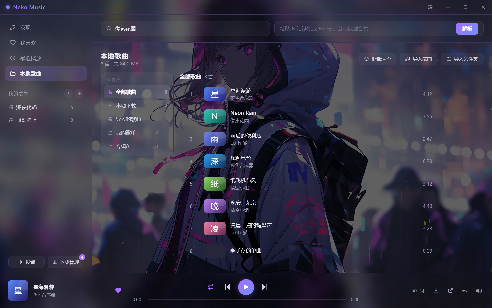

**左栏**按「来源」分组：**全部歌曲** / **本地下载** / 每个导入的文件夹 / **导入的歌曲**，每组带数量，点一下只看那一组。
**右栏**是这一组的歌，右上角「批量选择」。

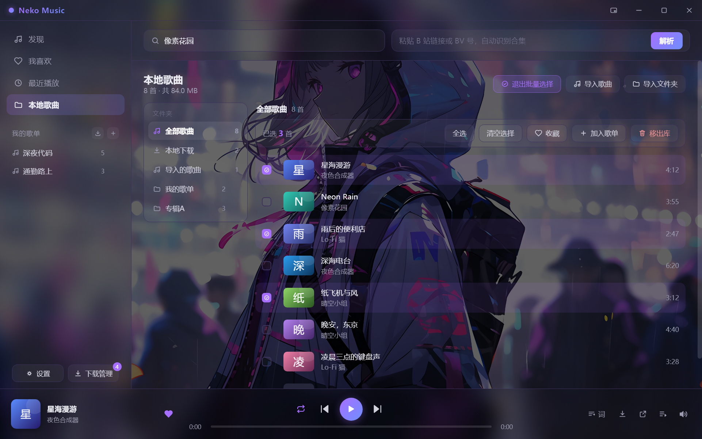

点「批量选择」进入勾选态：**点整行就能勾**（热区大），顶部工具条实时显示已选多少首，
可以 **全选 / 清空选择**，再一次性 **收藏 / 加入歌单 / 移出库**。
**全选只作用于当前分组**，换分组或离开这一页会自动退出勾选 —— 不会带着一屏勾选框跑到别处。

### 下载管理

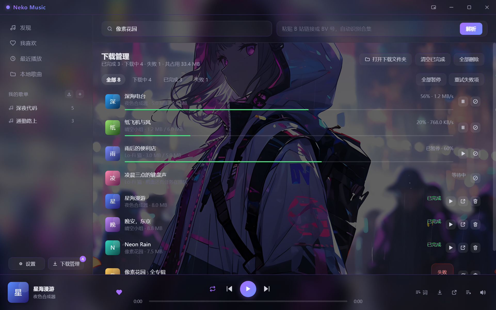

每条任务一行：**正在下**的显示进度条 + 百分比 + 实时速度，**已暂停**显示停在哪，
**已完成**的可直接播放 / 打开所在位置，**失败**的写明原因并可重试。
顶部一行统计「已完成 · 下载中 · 失败 · 共占用」，四个标签（全部 / 下载中 / 已完成 / 失败）按状态筛；
还有「全部暂停」「重试失败项」「清空已完成」「全部删除」。

### 合集「选集」面板

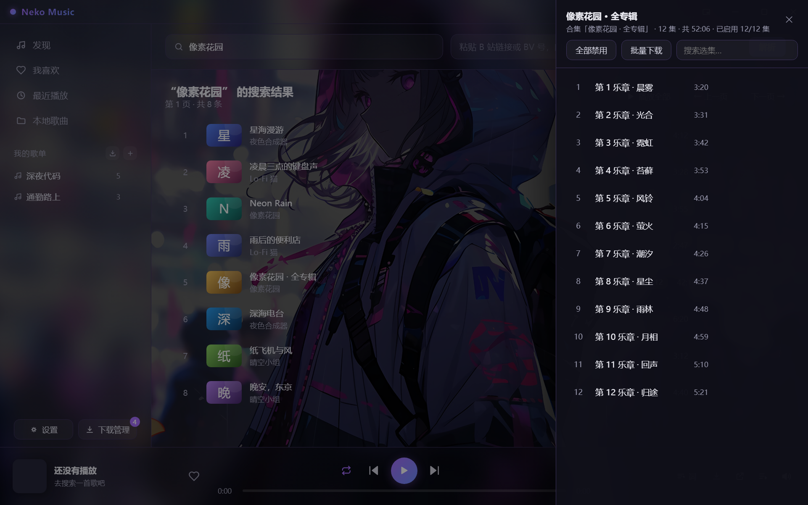

长视频 / 合集一键摊开成曲目表：每集可单独 **✅ 听 / 🚫 不听**，顶部有「全部启用 / 全部禁用」，
副标题实时显示「已启用 12/12 集」，还能直接在面板里搜索过滤。

### 整页歌词

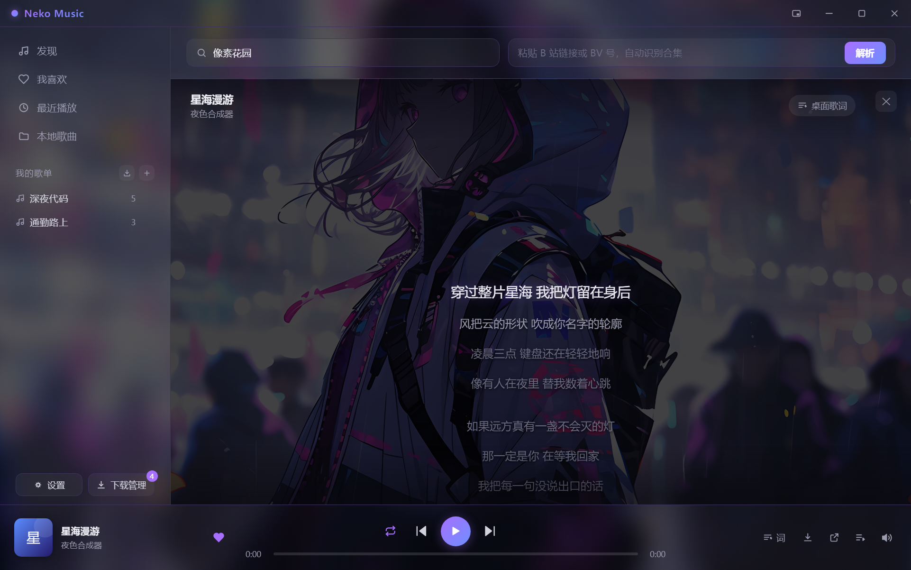

点播放条最左边那张封面展开（再点一次收起）。当前句高亮放大、**始终停在屏幕正中间**，整块跟着播放逐句滚动；**点某一句就跳到那句的时间**。

### mini 模式

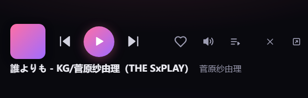

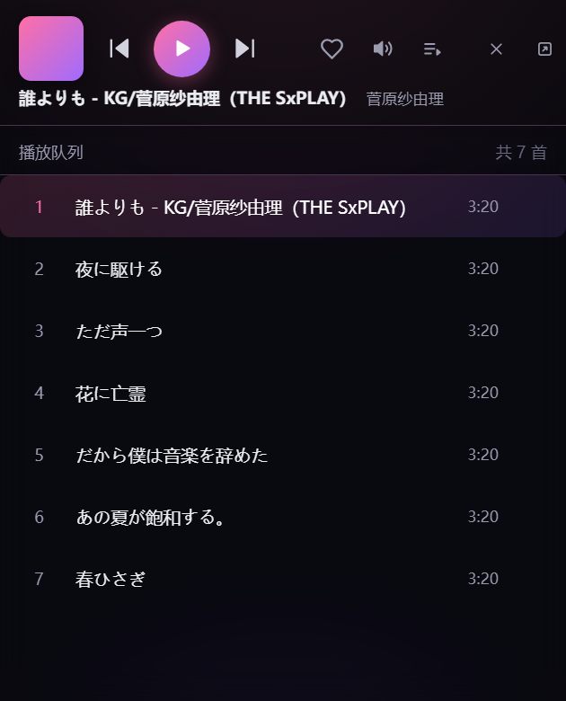

**收起态**（左图，420×132）就是一条小窗：封面在左、⏮⏸⏭ 在中、♡ 🔊 ☰ 在右、✕ ▢ 贴最右角，歌名单独一行（太长自动省略号）。**整条都能拖着走**（没有标题栏了，这一条就是窗口把手）。
**展开态**（右图，420×520）点 ☰ 往下长出来：列表就是**当前播放队列**，正在播的那首高亮；点任意一行直接跳播，点右边的垃圾桶把它移出队列。再点一次 ☰ 收回去。

### 外观设置（动态背景）

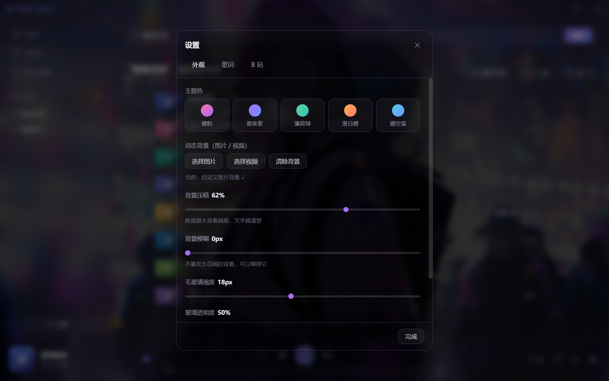

主题色、动态背景（图片 / 视频）、压暗 / 模糊 / 毛玻璃 / 透明度，以及动态背景专属的省显卡开关。

### 导入自己的 B 站收藏夹

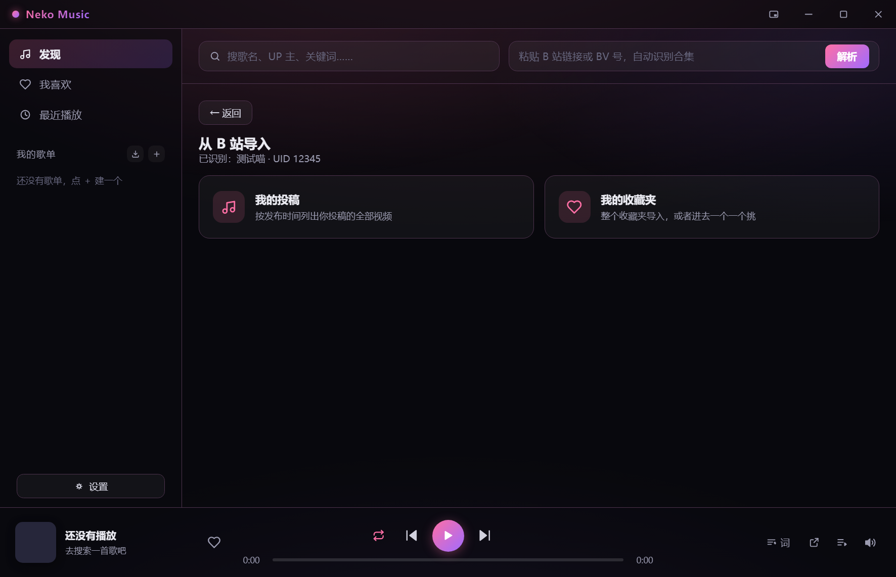

侧栏「我的歌单」旁边的 ⬇ 按钮进来的整页。第一屏先**认出你是谁**（昵称 + UID），再选来源。

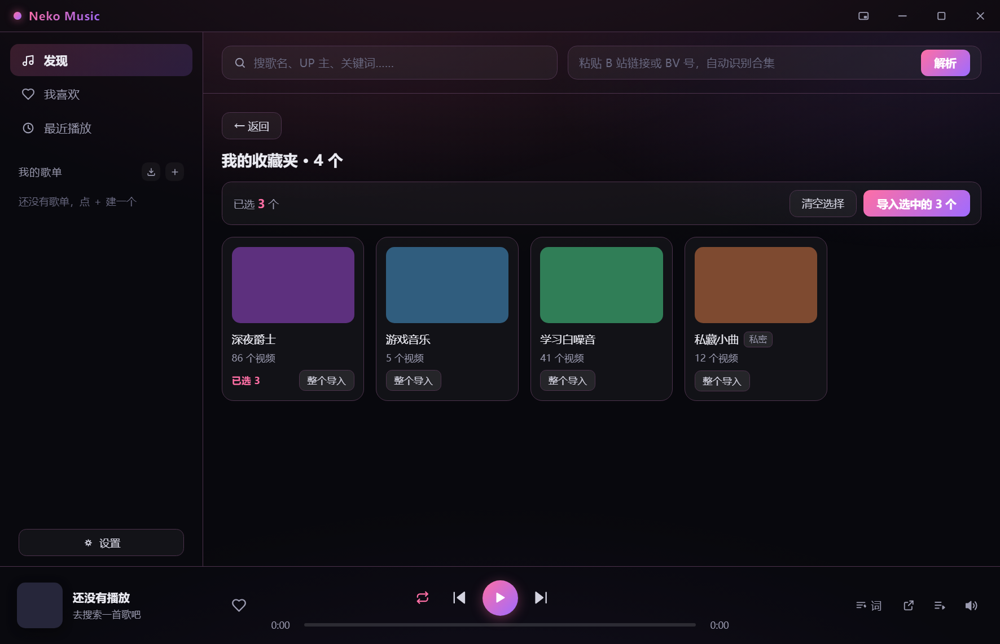

收藏夹列表：右下角「整个导入」一键整夹选中，卡片上的「已选 3」是**跨收藏夹累积**的角标（私密收藏夹带「私密」小标；最后一张「很久没听」是 B 站没给封面的，显示一个音符占位）。

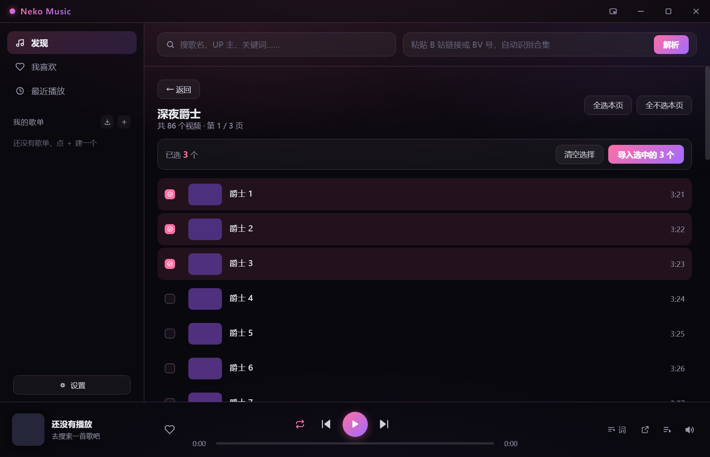

挑视频：点整行就能勾（热区大），勾上的行整行泛粉；顶部一直挂着「已选 N 个」，翻页、换收藏夹都不丢。

### 关闭时的小弹窗 + 设置「窗口」页

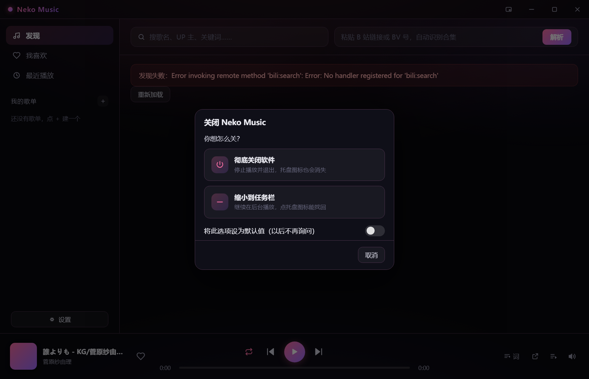

第一次点标题栏右上角那个 **⏻**（电源键）时弹出的小窗：两个大按钮任选一个，底下勾「将此选项设为默认值」下次就不再问。
之所以画成电源键而不是 ✕，是因为这个 ✕ 在标题栏里已经代表"关闭窗口"了，含义容易撞车。

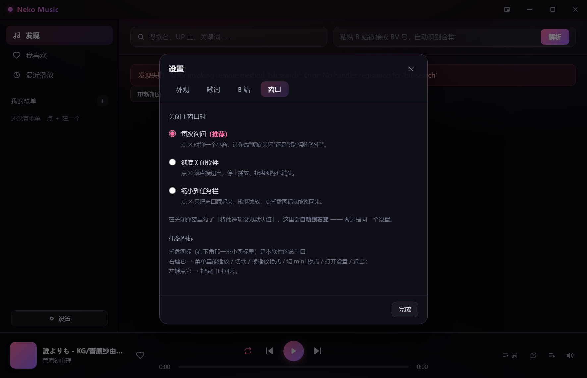

同一件事也能在 **设置 → 窗口** 里改：三选一（每次询问 / 彻底关闭 / 缩小到托盘），改完立刻生效。
这一页也解释了**托盘图标**是干什么的（它在屏幕右下角，窗口关掉后还能靠它把窗口叫回来）。

## 下载与安装

**① 直接装（最省事）** —— 去 [Releases](https://github.com/xingkinglb/neko-music/releases/latest) 页
下载 **`NekoMusic.Setup.<版本号>.exe`**（约 82 MB），双击一路下一步就行。
装完开始菜单和桌面都有快捷方式，卸载也在「设置 → 应用」里正常走。

> 首次启动若被 Windows SmartScreen 拦了一次，点「仍要运行」即可 ——
> 安装包没有做代码签名（签名证书要花钱），这是自建 Electron 应用的正常现象。

**② 用源码跑起来** —— 想改代码、追新提交的话走这条路，见下面的 [快速上手](#快速上手)。

**③ 自己打一个安装包** —— 见 [从源码构建](#从源码构建) 里的 `npm run build`。

## 快速上手

### 第 1 步：确认电脑有 Node.js

打开 PowerShell（按 `Win + R`，输入 `powershell` 回车），输入：

```powershell
node -v
```

显示 `v18.x` 或更高就 OK。如果提示"不是内部或外部命令"，去 <https://nodejs.org> 下载 LTS 版安装，一路下一步即可。

### 第 2 步：装依赖

```powershell
git clone https://github.com/xingkinglb/neko-music.git
cd neko-music
npm install
```

（`node_modules` 有好几百 MB，所以没有放进仓库。）

### 第 3 步：双击启动

**双击 `启动播放器.vbs`**，软件窗口就出来了 🎉 干净利落，不会多出任何黑窗口。

出问题时改双击 **`调试启动.bat`** —— 它会**故意**保留黑窗口，把运行日志和网页报错全部显示出来。
软件打不开、播放没声音的时候用它，把黑窗口里的内容截图发出来就行。平时不需要。

<details>
<summary>为什么启动文件是 <code>.vbs</code> 而不是 <code>.bat</code>？（值得一读的小坑）</summary>

`.bat` 一运行，Windows 就会开一个黑色的命令行窗口。而 `electron.exe` 是"图形程序"，
它会**继承**这个窗口 —— 等 bat 自己退出后，那个黑窗口还被 electron 拽着不放，
于是就成了一个关不掉的日志窗口，还不停往里刷消息。

`.vbs` 由 `wscript` 执行，而 `wscript` **天生没有控制台**，它启动的程序自然干干净净。
原理就一句：**让"没有控制台的东西"去启动它。**

**为什么不用 `npm start`？** 因为 `npm` / `npx` 依赖系统 PATH 里能找到 Node.js，
不同电脑配置不一样，很容易失败。而启动器直接调用 `node_modules\electron\dist\electron.exe` ——
**Electron 自带运行时**，是个独立程序，跟你装没装 Node.js 完全无关。

</details>

## 快捷键

| 按键 | 作用 |
|---|---|
| `空格` | 播放 / 暂停 |
| `Ctrl + ←` / `Ctrl + →` | 上一首 / 下一首 |
| `←` / `→` | 快退 / 快进 5 秒 |
| `↑` / `↓` | 音量 ±5 |
| `Ctrl + L` | 开 / 关**桌面歌词**（悬浮窗） |
| `Ctrl + D` | 开 / 关**整页歌词** |
| `Ctrl + M` | 进 / 出 **mini 模式**（缩成一条小窗） |
| `Esc` | 收起整页歌词 / 关闭设置面板 |
| `F11` | 全屏 |

> 音量还有两个不用记的操作：**点喇叭图标 = 静音 / 取消静音**，**在音量那一块上滚滚轮 = 调音量**。
> 平时播放条右侧只显示一个喇叭图标，鼠标移上去才会向上浮出竖向滑杆。
>
> 💡 光标在搜索框里打字时，以上快捷键全部自动让位，不会乱触发。

## 常见问题

### 怎么用起来

<details>
<summary><b>播放没声音？</b></summary>

先检查右下角系统音量，再把鼠标移到播放器右下角的**喇叭图标**上，把浮出来的竖条拉到中间以上
（点一下喇叭图标是静音开关，别是静音状态）。如果还是不行，双击 `调试启动.bat` 启动它，
窗口里会显示出错原因。

</details>

<details>
<summary><b>提示"音频加载失败了，可能链接已过期"？</b></summary>

B 站的音频地址有时效（几小时）。重新点一下这首歌就好。

</details>

<details>
<summary><b>搜索成功但点播放没反应？</b></summary>

某些视频是会员专属或有版权限制，拿不到音频流。换一首试试。

</details>

<details>
<summary><b>双击 <code>启动播放器.vbs</code> 没有任何反应？</b></summary>

按这个顺序排查：

1. 先试 **双击 `调试启动.bat`** —— 它会把错误直接打出来，截图发出来最快
2. 确认 `node_modules\electron\dist\electron.exe` 这个文件存在（应该有 188 MB 左右）
3. 打开终端（地址栏输入 `cmd` 回车），运行 `node_modules\electron\dist\electron.exe .`，把红色报错发出来

> 万一双击 `.vbs` 被系统或杀毒软件拦了，就用 `调试启动.bat` 代替，功能完全一样，
> 只是会多一个黑窗口（那个窗口是故意的，关掉软件它自己会消失）。

</details>

<details>
<summary><b>明明没开别的程序，却多了一个黑窗口不停刷字？</b></summary>

那是 **`.bat` 启动方式**的特征 —— electron 会继承 bat 的控制台，bat 退出后窗口被它拽着不放。
改用 `启动播放器.vbs` 就没有了。

</details>

### 搜索 / 限流

<details>
<summary><b>搜索时好时坏，或者干脆搜不出来？（B 站限流）</b></summary>

B 站对未登录的请求有**随机限流**。登录一下就能稳定非常多。

**最快的办法是扫码**：点左下角 **⚙ 设置** → 切到「B 站」标签页 → 点「**扫码登录**」，
用手机 B 站 App 扫一扫、在手机上点「确认登录」，就好了。全程不用碰开发者工具。

手机不在手边、或者想换账号时扫码不灵，就手动填 Cookie：

1. 浏览器打开 <https://www.bilibili.com> 并登录
2. 按 `F12` → 点顶部「Application」（中文版叫「应用程序」）
3. 左侧找 `Cookies` → `https://www.bilibili.com`
4. 找到名字是 **`SESSDATA`** 的那一行，复制它的值
5. 回到播放器，同一个「B 站」标签页，粘到下面那个框里

**不登录也能用，只是偶尔需要多点两次。**

> 手动填的时候，浏览器开发者工具里复制 **Cookie Value** 那一列的内容即可，**不用**自己加 `SESSDATA=` 前缀。

</details>

<details>
<summary><b>歌词取不到 / 取到别的视频的歌词？</b></summary>

取字幕需要先登录（见上一条：扫码或手填 Cookie 都行）。没登录的话点了「词」会提示你去登录 —— 这是正常的，不是坏了。

B 站曾经把旧的字幕接口 `/x/player/v2` **悄悄降级**：它不报错，而是随机返回**别的视频**的字幕，
而且返回码还是"成功"。现在改走 B 站网页播放器真正在用的那条接口（带 WBI 签名），
另外还有三重兜底：核对 `cid`、识别诱饵内容、失败自动重试 3 次；万一对不上，
歌词顶部会显示橙色提示条告诉你。

有些句子被字幕本身切碎时，软件现在只会在**唱歌置信度高、时间轴可靠、合并后仍较短**的情况下自动并回去。
如果时间轴无法判断句界，就保持字幕原样；因此不是每一首都能修正分段。

真的遇到取不到时，多数是**没填 Cookie** 或**这个视频确实没有字幕**，界面上会分别说明原因。
也可以点播放条上的 **↗ 打开视频** 去 B 站网页版直接看字幕。

</details>

### 背景 / 界面

<details>
<summary><b>选了背景图却不显示 / 显示裂图？</b></summary>

背景走 `bg://` 私有协议读取，文件存在 `%APPDATA%\neko-music\backgrounds\`。排查：

1. 确认图片是 **png / jpg / webp / gif / bmp**
2. 双击 `调试启动.bat` 看有没有红色报错
3. 点「清除背景」再重新选一次

</details>

<details>
<summary><b>动态背景（视频）选了不播 / 一片黑？</b></summary>

1. 确认格式是 **mp4 / webm / mov**（AVI、MKV 等不保证能播，选了会提示）
2. 确认大小 **≤ 200MB**（超了会提示换小的）
3. 视频默认是**静音 + 循环**的，如果你觉得"没声音"——那是正常的，静音开关在设置里
4. 窗口最小化、切到别的软件、或者**打开设置面板**时，视频会**自动暂停**（省电），回到前台才会接着播
5. 素材分辨率太大（宽 > 1920）会提示你换小的，**压到 720p / 30fps 最省显卡**

</details>

<details>
<summary><b>开了动态背景，显卡占用有点高？</b></summary>

打开 **设置 → 外观 → 「降低毛玻璃（省显卡）」**（默认就是开的）。
它会在动态背景时关掉四块常驻面板的实时模糊 —— 那是最吃显卡的地方。
另外把素材压到 720p / 24~30fps 收益也很明显。

</details>

<details>
<summary><b>封面是空白的？</b></summary>

已经修好了。原因是 B 站返回的封面地址是 http，被页面的安全策略拦下。如果你看到的是老版本，重启一下软件即可。

</details>

<details>
<summary><b>软件打不开 / 白屏？</b></summary>

双击 `调试启动.bat`，看黑窗口里打印的报错信息 —— 那里会有明确的原因。

</details>

### AI 歌词对不上 / 看着像编的

先分清两条路：

| 你开的开关 | 它做了什么 | 可靠性 |
|---|---|---|
| **AI 整理** | 取到 B 站字幕，让 AI 只改错别字和断句，**时间轴用字幕原值** | ✅ 可靠 |
| **AI 生成** | 没有字幕，让 AI 凭记忆整段写 + 估时间轴 | ⚠️ 大概率不对 |

**判断是不是编的**：点歌词页左上角那颗小标（「AI 生成 · 时间轴为估算」/「AI 整理版」），
能看到三页 —— 模型的回复原文、它的思考过程、以及发出去的提示词。如果回复里它自己在说
"我不确定""以下是我推测的"，那就是编的。

**怎么办**：

1. 这首歌如果有 B 站字幕 → 只开「AI 整理」，那条路是准的
2. 冷门歌 / 翻唱 / 改词版 → 换成**不思考的普通模型**（`gpt-4o-mini` / `deepseek-chat` / `qwen-plus`），
   推理型模型写歌词很不划算（token 全花在"想"上，正文经常被截断）
3. 兜底生成的结果**只当参考** —— 它的价值是"大概知道在唱什么"，不是"精确歌词"
4. 实在想要准确的，只能等 UP 主自己传字幕，或者去 B 站看原视频

### 数据安全

<details>
<summary><b>改代码改坏了，歌单收藏会不会丢？</b></summary>

不会，你的数据在**另一个地方**，跟代码完全分开：

```
C:\Users\<你的用户名>\AppData\Roaming\neko-music\neko-data.json
```

怎么手动备份：按 `Win + R`，输入 `%APPDATA%\neko-music` 回车，把 `neko-data.json` 复制一份到桌面就行。

万一真丢了数据，把备份文件改回 `neko-data.json` 放回原目录，重启软件即可恢复。

</details>

<details>
<summary><b>我的歌单、Cookie、壁纸会被上传吗？</b></summary>

不会。用户记忆（歌单 / 收藏 / 历史 / 设置）、B 站 Cookie、自定义背景**全部只存在本机 `%APPDATA%\neko-music\`**，
不在项目目录里，也**不会随 Git 上传** —— `.gitignore` 里另有保险条目兜底。
仓库里分享的代码不包含任何私人存档；换电脑时请自行备份该目录。

</details>

## 更新日志

最近两版的变化。完整历史（从 v2.0 到现在每一次改动）见 [CHANGELOG.md](CHANGELOG.md)。

### v2.13.0 — 2026-11-05（听够才算听过、能倍速、搜索不再被合集霸屏、多了听歌统计）

- 🎧 **听够 30 秒才算「听过」** —— 以前是点开就进历史，点着玩两下，「最近播放」就多了一堆没听的歌。
  现在要真的听一会儿才记：长歌听满 30 秒，短片（20 秒那种）要听到 90%；**拖进度条不算**。
- 🎚 **倍速 0.75×~2.0×** —— 播放条右边那个写着「1.0×」的小按钮。变调已关，1.5× 不变鸭子声；
  按钮宽度是固定的，切档不会把播放条挤一下。
- 🔍 **搜索不再被三小时合集霸屏** —— B 站排序优化的是点击率，搜「晴天」第一页全是合集和翻唱串烧。
  现在本地再排一次（标题命中 / 时长合理 / 整串命中 / B 站原序四项加权），原曲能顶上去；
  结果页那行「已按相关度重排」点一下可以换回 B 站原序。
- 📊 **侧栏多了「听歌统计」** —— 四张卡 + 近 30 天柱状图 + 最常听的 30 首歌（单列铺满，点一下直接播）
  + 最常听的 10 位 UP。本地歌也进榜，带「本地」小标；合集里的每一集也算到对应 UP 头上。
- 🐛 修了三个：倍速菜单关不掉（`hidden` 被 `display:flex` 盖住）、合集里的歌听再多遍 UP 榜也不涨
  （曲目表没带 uid）、统计页在浅色壁纸上看不清（底色该用玻璃黑而不是淡白）。
- ✅ 静态自检 **68 大类**；离屏实测过倍速生效、阈值三档、拖条过滤、统计页渲染。

<details>
<summary>v2.12.5（发现页可定制、列表能排序、我的主页、歌单拖动）</summary>

- 🧹 存档从 7.49 MB 瘦到 KB 级（合集缓存拆去独立文件，自动迁移）
- 🔍 发现页的关键词可改可删可加，数量也能直接输入
- ↕️ 「我喜欢」和歌单能按 歌名 / 歌手 / 时长 / 添加顺序 排，点第 3 行播的就是第 3 首
- 👤 侧栏「我的主页」：登录后直接看自己的收藏夹，点开就像歌单一样听
- 🗂 歌单能拖动排序（hover 才浮现的小把手）
- 🎯 修：定位按钮在歌单里总是失败 / 合集里的歌也能定位了

</details>

> 更早的版本（v2.0 ~ v2.12.4）见 [CHANGELOG.md](CHANGELOG.md) ·
> 所有发布见 [Releases](https://github.com/xingkinglb/neko-music/releases)

## 它是怎么工作的

```
Music/
├── package.json          ← 项目说明书（叫什么名、要装哪些库）
├── 启动播放器.vbs         ← 双击启动（没有黑窗口）
├── 调试启动.bat           ← 出问题时双击它看日志
├── README.md             ← 你正在看的这份
├── CHANGELOG.md          ← 每一次改动做了什么、为什么改
├── docs/
│   ├── 技术说明.md        ← 零基础讲解 + 每个"为什么这么写"的来龙去脉
│   ├── 路线图.md          ← 还没做的 / 明确不做的
│   └── 参考实现研究-biu.md ← 动手前对同类项目做的一轮功课
└── src/
    ├── main.js           ← 主进程（幕后老板，还负责托盘、任务栏按钮、开第二个歌词窗口）
    ├── preload.js        ← 传话筒（安全的沟通桥梁）
    ├── bilibili.js       ← 和 B 站对话的翻译官（搜索 / 取流 / 字幕 / 收藏夹）
    ├── search-rank.js    ← 搜索结果的相关性重排（纯函数，能单测）
    ├── bg-protocol.js    ← 壁纸专用的 bg:// 协议（含视频分段传输）
    ├── local-protocol.js ← 本地歌曲专用的 local:// 协议（只放行登记过的文件）
    ├── win-mini.js       ← mini 模式的窗口尺寸（收起 420×132 / 展开 420×520）
    ├── app-menus.js      ← 托盘菜单 / 任务栏任务 / 关窗行为 / 命令行参数（纯数据，好测）
    ├── store-migrate.js  ← 存档读写时的"补洞"（老存档缺字段就补默认值，不认识的字段原样留着）
    ├── stats-store.js    ← 听歌统计的落盘（独立 stats.json，原子写 + 上限淘汰）
    ├── queue-store.js    ← 播放队列的落盘（独立 queue.json）
    ├── cache-collect.js  ← 合集曲目表缓存（独立 cache-collect.json）
    ├── downloader.js     ← 下载器（断点续传 / 暂停 / 重试）
    ├── qr-login.js       ← 扫码登录（出二维码 + 轮询状态）
    ├── ai-lyrics.js      ← AI 歌词（Key 加密存本地，界面永远拿不到明文）
    ├── assets/           ← 图标：app.png + tray.ico + menu-*.png + thumb-*.png
    └── ui/               ← 界面（骨架 index.html / 样式 style.css / 逻辑 app.js + 歌词窗）
```

> `stats-store` / `queue-store` / `cache-collect` 都单独一个文件、单独一份 json，
> 理由是一样的：主存档是**全量重写**，这三样都是"高频小改动"，
> 混进去等于每改一次就重写几百 KB。

**为什么分 `main` 和 `ui` 两个进程？** `ui/` 跑在"网页世界"，安全但没权限；
`main.js` 跑在"系统世界"，有权限但画不了界面；两个世界通过 `preload.js` 喊话。

三个最关键的技术点：**① wbi 签名**（B 站要求每个搜索请求带签名）、
**② `bili://` 协议**（`<audio>` 没法自定义请求头，于是自己造一个协议由主进程代发带 `Referer` 的请求）、
**③ 只取音频不下载视频**（B 站的 DASH 格式把音视频分开存，取纯音频只要几 MB）。

👉 想看详细的零基础讲解（含 `bg://` 协议、CSP 破图、动态背景的性能成因），见 **[docs/技术说明.md](docs/技术说明.md)**。

## 从源码构建

```powershell
npm install     # 装依赖（第一次要几分钟）
npm start       # 直接跑起来（等价于双击 启动播放器.vbs）
npm run build   # 打包成 Windows 安装包，产物在 dist/
```

> 第一次打包会下载额外工具，比较慢。如果卡在下载，说明网络不通，可以跳过这步 ——
> 用 `启动播放器.vbs` 已经足够日常使用了。

改完代码想自己验一遍？仓库里带了一套自检脚本（静态自检 68 大类 + 35 个离屏实测脚本），跑法见
[docs/技术说明.md 的「自检与实测体系」](docs/技术说明.md#自检与实测体系)。

## 许可证

[MIT](LICENSE) © 2026 Neo

## 致谢

- 灵感来自 [th-ch/youtube-music](https://github.com/th-ch/youtube-music) 等项目
- 动态背景的省电策略参考了开源动态壁纸 [Lively Wallpaper](https://github.com/rocksdanister/lively) 的官方性能文档
- 感谢所有把作品公开在 B 站上的 UP 主 🎧

<div align="center">

*Made with 💗 by Neko*

</div>
