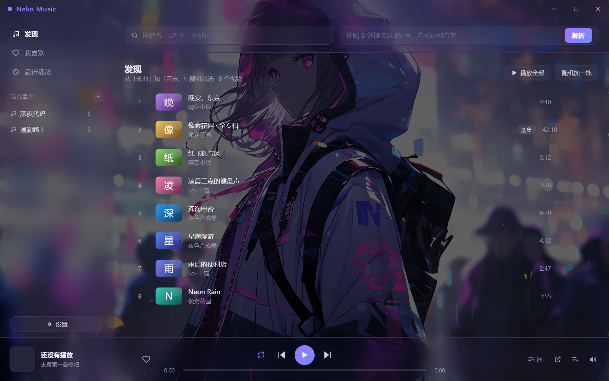
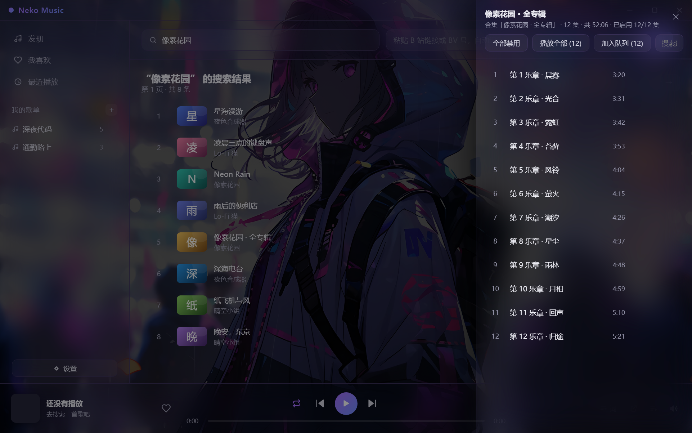
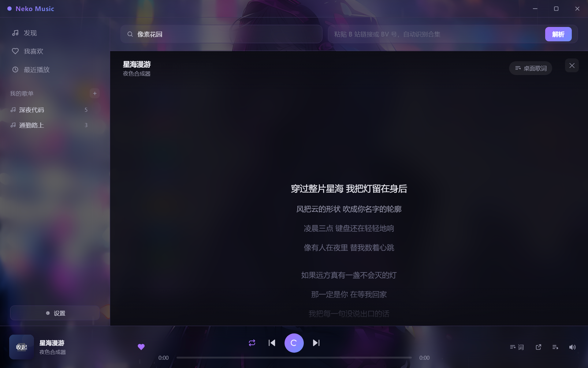
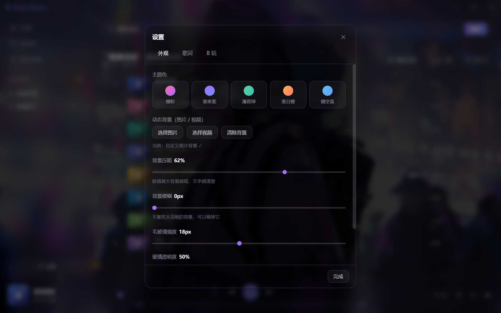

<div align="center">

# 🎧 Neko Music

**用 B 站当曲库的桌面音乐播放器**

把 B 站视频里的音频在线播放出来 —— 搜歌、合集、歌单、收藏、歌词、动态背景，一个不少。




</div>

> [!IMPORTANT]
> **免责声明**
>
> 本项目是**个人学习 Electron 与网络编程**的练习作品，与哔哩哔哩官方**没有任何关系**，也未获其授权或认可。
> 它只播放 B 站上**公开视频的音频流**，**不下载、不存储、不传播**任何内容，也不提供绕过登录或付费限制的能力。
> 请尊重内容创作者的版权，不要用于商业用途或大规模抓取。你播放的内容版权归 B 站及原 UP 主所有。
> 第三方接口随时可能变更，因此**不保证长期可用**（软件按"现状"提供）。

---

## 目录

- [✨ 功能](#功能)
- [📸 界面预览](#界面预览)
- [📥 下载与安装](#下载与安装)
- [🚀 快速上手](#快速上手)
- [⌨️ 快捷键](#快捷键)
- [❓ 常见问题](#常见问题)
- [🔄 更新日志](#更新日志)
- [🛠 它是怎么工作的](#它是怎么工作的)
- [🧱 从源码构建](#从源码构建)
- [📄 许可证](#许可证)
- [🙏 致谢](#致谢)

---

## 功能

- 🎵 **B 站即曲库** —— 搜歌名 / UP 主 / 关键词，或者直接把 BV 号、视频链接、短链（`b23.tv/xxx`）粘进右边的框点「解析」
- 📚 **合集自动摊开** —— 遇到「130 首歌曲合集」这种七八个小时的长视频，点一下「选集 N」就拆成一集一集来听，**还能单独关掉不想听的那几集**
- ♡ **收藏 · 自建歌单 · 播放历史** —— 数据全部存在你自己电脑上，关掉再开还在；也能一键导入某位 UP 的公开收藏夹
- 📝 **歌词两种看法** —— 桌面悬浮歌词（浮在所有软件最上面，最小化也照样跟着唱）+ 整页歌词（逐句滚动、点哪句跳哪句）
- 🗂 **播放队列抽屉** —— 点播放条上的「播放队列」，从右侧拉出「接下来播什么」的列表：能直接跳播、把某首移出去、清空，还能在队列里搜索过滤
- 🔁 **四种播放模式** —— 列表循环（默认）/ 单曲循环 / 随机播放 / 顺序播放，点播放条上的按钮循环切换，图标一眼看出当前是哪种
- 🖼 **动态背景** —— 用图片或视频当壁纸，配「压暗 / 模糊 / 毛玻璃 / 透明度」四根滑杆；视频背景还有专门的**省显卡**开关
- 🎨 **五套主题色 + 无边框界面** —— 自绘标题栏、统一单色 SVG 图标、磨砂半透明面板，切换主题只换点缀色、绝不跟你的壁纸打架

## 界面预览

> 下面几张都是**实机截图**。最上面那张大图是 **发现页**（启动默认停在这里）—— 用 B 站「歌曲」「音乐」两个关键词搜索、去重后随机挑 8~12 个视频推荐给你，点「随机换一批」重新抽。
> 界面长什么样取决于你选了什么背景，我这几张用的是自己的壁纸。

### 合集「选集」面板



长视频 / 合集一键摊开成曲目表：每集可单独 **✅ 听 / 🚫 不听**，顶部有「全部启用 / 全部禁用」，
副标题实时显示「已启用 12/12 集」，还能直接在面板里搜索过滤。

### 整页歌词



点播放条最左边那张封面展开（再点一次收起）。当前句高亮放大、**始终停在屏幕正中间**，整块跟着播放逐句滚动；**点某一句就跳到那句的时间**。

### 外观设置（动态背景）



主题色、动态背景（图片 / 视频）、压暗 / 模糊 / 毛玻璃 / 透明度，以及动态背景专属的省显卡开关。

## 下载与安装

**目前还没有打包好的安装包**，两条路：

**① 用源码跑起来（推荐，最省事）** —— 看下面的 [快速上手](#快速上手)。

**② 自己打一个安装包** —— 看 [从源码构建](#从源码构建) 里的 `npm run build`。

> 打好包之后会挂到 [Releases](https://github.com/xingkinglb/neko-music/releases) 页，
> 到时候就能直接下载双击安装了。现在那一页放的是各版本的源码快照。

## 快速上手

### 第 1 步：确认电脑有 Node.js

打开 PowerShell（按 `Win + R`，输入 `powershell` 回车），输入：

```powershell
node -v
```

显示 `v18.x` 或更高就 OK。如果提示"不是内部或外部命令"，去 <https://nodejs.org> 下载 LTS 版安装，一路下一步即可。

### 第 2 步：装依赖

```powershell
git clone https://github.com/xingkinglb/neko-music.git
cd neko-music
npm install
```

（`node_modules` 有好几百 MB，所以没有放进仓库。）

### 第 3 步：双击启动

**双击 `启动播放器.vbs`**，软件窗口就出来了 🎉 干净利落，不会多出任何黑窗口。

出问题时改双击 **`调试启动.bat`** —— 它会**故意**保留黑窗口，把运行日志和网页报错全部显示出来。
软件打不开、播放没声音的时候用它，把黑窗口里的内容截图发出来就行。平时不需要。

<details>
<summary>为什么启动文件是 <code>.vbs</code> 而不是 <code>.bat</code>？（值得一读的小坑）</summary>

`.bat` 一运行，Windows 就会开一个黑色的命令行窗口。而 `electron.exe` 是"图形程序"，
它会**继承**这个窗口 —— 等 bat 自己退出后，那个黑窗口还被 electron 拽着不放，
于是就成了一个关不掉的日志窗口，还不停往里刷消息。

`.vbs` 由 `wscript` 执行，而 `wscript` **天生没有控制台**，它启动的程序自然干干净净。
原理就一句：**让"没有控制台的东西"去启动它。**

**为什么不用 `npm start`？** 因为 `npm` / `npx` 依赖系统 PATH 里能找到 Node.js，
不同电脑配置不一样，很容易失败。而启动器直接调用 `node_modules\electron\dist\electron.exe` ——
**Electron 自带运行时**，是个独立程序，跟你装没装 Node.js 完全无关。

</details>

## 快捷键

| 按键 | 作用 |
|---|---|
| `空格` | 播放 / 暂停 |
| `Ctrl + ←` / `Ctrl + →` | 上一首 / 下一首 |
| `←` / `→` | 快退 / 快进 5 秒 |
| `↑` / `↓` | 音量 ±5 |
| `Ctrl + L` | 开 / 关**桌面歌词**（悬浮窗） |
| `Ctrl + D` | 开 / 关**整页歌词** |
| `Esc` | 收起整页歌词 / 关闭设置面板 |
| `F11` | 全屏 |

> 音量还有两个不用记的操作：**点喇叭图标 = 静音 / 取消静音**，**在音量那一块上滚滚轮 = 调音量**。
> 平时播放条右侧只显示一个喇叭图标，鼠标移上去才会向上浮出竖向滑杆。
>
> 💡 光标在搜索框里打字时，以上快捷键全部自动让位，不会乱触发。

## 常见问题

### 怎么用起来

<details>
<summary><b>播放没声音？</b></summary>

先检查右下角系统音量，再把鼠标移到播放器右下角的**喇叭图标**上，把浮出来的竖条拉到中间以上
（点一下喇叭图标是静音开关，别是静音状态）。如果还是不行，双击 `调试启动.bat` 启动它，
窗口里会显示出错原因。

</details>

<details>
<summary><b>提示"音频加载失败了，可能链接已过期"？</b></summary>

B 站的音频地址有时效（几小时）。重新点一下这首歌就好。

</details>

<details>
<summary><b>搜索成功但点播放没反应？</b></summary>

某些视频是会员专属或有版权限制，拿不到音频流。换一首试试。

</details>

<details>
<summary><b>双击 <code>启动播放器.vbs</code> 没有任何反应？</b></summary>

按这个顺序排查：

1. 先试 **双击 `调试启动.bat`** —— 它会把错误直接打出来，截图发出来最快
2. 确认 `node_modules\electron\dist\electron.exe` 这个文件存在（应该有 188 MB 左右）
3. 打开终端（地址栏输入 `cmd` 回车），运行 `node_modules\electron\dist\electron.exe .`，把红色报错发出来

> 万一双击 `.vbs` 被系统或杀毒软件拦了，就用 `调试启动.bat` 代替，功能完全一样，
> 只是会多一个黑窗口（那个窗口是故意的，关掉软件它自己会消失）。

</details>

<details>
<summary><b>明明没开别的程序，却多了一个黑窗口不停刷字？</b></summary>

那是 **`.bat` 启动方式**的特征 —— electron 会继承 bat 的控制台，bat 退出后窗口被它拽着不放。
改用 `启动播放器.vbs` 就没有了。

</details>

### 搜索 / 限流

<details>
<summary><b>搜索时好时坏，或者干脆搜不出来？（B 站限流）</b></summary>

B 站对未登录的请求有**随机限流**。填一个 Cookie 就能稳定非常多：

1. 浏览器打开 <https://www.bilibili.com> 并登录
2. 按 `F12` → 点顶部「Application」（中文版叫「应用程序」）
3. 左侧找 `Cookies` → `https://www.bilibili.com`
4. 找到名字是 **`SESSDATA`** 的那一行，复制它的值
5. 回到播放器，点左下角 **⚙ 设置**，切到「B 站」标签页，把 SESSDATA 粘进去

**不填也能用，只是偶尔需要多点两次。**

> 填的时候，浏览器开发者工具里复制 **Cookie Value** 那一列的内容即可，**不用**自己加 `SESSDATA=` 前缀。

</details>

<details>
<summary><b>歌词取不到 / 取到别的视频的歌词？</b></summary>

取字幕需要先填 Cookie（见上一条）。没填的话点了「词」会提示你去填 —— 这是正常的，不是坏了。

B 站曾经把旧的字幕接口 `/x/player/v2` **悄悄降级**：它不报错，而是随机返回**别的视频**的字幕，
而且返回码还是"成功"。现在改走 B 站网页播放器真正在用的那条接口（带 WBI 签名），
另外还有三重兜底：核对 `cid`、识别诱饵内容、失败自动重试 3 次；万一对不上，
歌词顶部会显示橙色提示条告诉你。

真的遇到取不到时，多数是**没填 Cookie** 或**这个视频确实没有字幕**，界面上会分别说明原因。
也可以点播放条上的 **↗ 打开视频** 去 B 站网页版直接看字幕。

</details>

### 背景 / 界面

<details>
<summary><b>选了背景图却不显示 / 显示裂图？</b></summary>

背景走 `bg://` 私有协议读取，文件存在 `%APPDATA%\neko-music\backgrounds\`。排查：

1. 确认图片是 **png / jpg / webp / gif / bmp**
2. 双击 `调试启动.bat` 看有没有红色报错
3. 点「清除背景」再重新选一次

</details>

<details>
<summary><b>动态背景（视频）选了不播 / 一片黑？</b></summary>

1. 确认格式是 **mp4 / webm / mov**（AVI、MKV 等不保证能播，选了会提示）
2. 确认大小 **≤ 200MB**（超了会提示换小的）
3. 视频默认是**静音 + 循环**的，如果你觉得"没声音"——那是正常的，静音开关在设置里
4. 窗口最小化、切到别的软件、或者**打开设置面板**时，视频会**自动暂停**（省电），回到前台才会接着播
5. 素材分辨率太大（宽 > 1920）会提示你换小的，**压到 720p / 30fps 最省显卡**

</details>

<details>
<summary><b>开了动态背景，显卡占用有点高？</b></summary>

打开 **设置 → 外观 → 「降低毛玻璃（省显卡）」**（默认就是开的）。
它会在动态背景时关掉四块常驻面板的实时模糊 —— 那是最吃显卡的地方。
另外把素材压到 720p / 24~30fps 收益也很明显。

</details>

<details>
<summary><b>封面是空白的？</b></summary>

已经修好了。原因是 B 站返回的封面地址是 http，被页面的安全策略拦下。如果你看到的是老版本，重启一下软件即可。

</details>

<details>
<summary><b>软件打不开 / 白屏？</b></summary>

双击 `调试启动.bat`，看黑窗口里打印的报错信息 —— 那里会有明确的原因。

</details>

### 数据安全

<details>
<summary><b>改代码改坏了，歌单收藏会不会丢？</b></summary>

不会，你的数据在**另一个地方**，跟代码完全分开：

```
C:\Users\<你的用户名>\AppData\Roaming\neko-music\neko-data.json
```

怎么手动备份：按 `Win + R`，输入 `%APPDATA%\neko-music` 回车，把 `neko-data.json` 复制一份到桌面就行。

万一真丢了数据，把备份文件改回 `neko-data.json` 放回原目录，重启软件即可恢复。

</details>

<details>
<summary><b>我的歌单、Cookie、壁纸会被上传吗？</b></summary>

不会。用户记忆（歌单 / 收藏 / 历史 / 设置）、B 站 Cookie、自定义背景**全部只存在本机 `%APPDATA%\neko-music\`**，
不在项目目录里，也**不会随 Git 上传** —— `.gitignore` 里另有保险条目兜底。
仓库里分享的代码不包含任何私人存档；换电脑时请自行备份该目录。

</details>

## 更新日志

### 最近更新（v1.9.0）

- 🖼 **修好动态背景不随窗口缩放**：以前只有全屏才显示正常，窗口化时视频被裁成"只看到左上角一块"
- ⚡ **大幅降低动态背景的显卡占用**：动态背景时自动关掉四块常驻面板的实时毛玻璃（可在设置里关），并把模糊从视频身上摘掉
- 💤 **补齐"该停就停"**：窗口失焦、打开设置面板、最小化都会暂停背景视频，回来自动接着播
- 📝 **改名「动态背景」**（原来叫"视频背景"），并把"背景模糊"在视频模式下置灰说明原因
- 📄 **重做项目主页**：补上 `LICENSE`、Issue 模板、版本 tag 与 Release，README 改成面向访客的项目门面

> 完整历史见 [CHANGELOG.md](CHANGELOG.md) ·
> 所有版本见 [Releases](https://github.com/xingkinglb/neko-music/releases)

## 它是怎么工作的

```
Music/
├── package.json          ← 项目说明书（叫什么名、要装哪些库）
├── 启动播放器.vbs         ← 双击启动（没有黑窗口）
├── 调试启动.bat           ← 出问题时双击它看日志
└── src/
    ├── main.js           ← 主进程（幕后老板，还负责开第二个歌词窗口）
    ├── preload.js        ← 传话筒（安全的沟通桥梁）
    ├── bilibili.js       ← 和 B 站对话的翻译官
    ├── bg-protocol.js    ← 背景壁纸专用的 bg:// 协议（含视频分段传输）
    └── ui/               ← 界面（骨架 index.html / 样式 style.css / 逻辑 app.js + 歌词窗）
```

**为什么分 `main` 和 `ui` 两个进程？** `ui/` 跑在"网页世界"，安全但没权限；
`main.js` 跑在"系统世界"，有权限但画不了界面；两个世界通过 `preload.js` 喊话。

三个最关键的技术点：**① wbi 签名**（B 站要求每个搜索请求带签名）、
**② `bili://` 协议**（`<audio>` 没法自定义请求头，于是自己造一个协议由主进程代发带 `Referer` 的请求）、
**③ 只取音频不下载视频**（B 站的 DASH 格式把音视频分开存，取纯音频只要几 MB）。

👉 想看详细的零基础讲解（含 `bg://` 协议、CSP 破图、动态背景的性能成因），见 **[docs/技术说明.md](docs/技术说明.md)**。

## 从源码构建

```powershell
npm install     # 装依赖（第一次要几分钟）
npm start       # 直接跑起来（等价于双击 启动播放器.vbs）
npm run build   # 打包成 Windows 安装包，产物在 dist/
```

> 第一次打包会下载额外工具，比较慢。如果卡在下载，说明网络不通，可以跳过这步 ——
> 用 `启动播放器.vbs` 已经足够日常使用了。

改完代码想自己验一遍？仓库里带了一套自检脚本（静态自检 + 6 套离屏实测），跑法见
[docs/技术说明.md 的「自检与实测体系」](docs/技术说明.md#自检与实测体系)。

## 许可证

[MIT](LICENSE) © 2026 Neo

## 致谢

- 灵感来自 [th-ch/youtube-music](https://github.com/th-ch/youtube-music) 等项目
- 动态背景的省电策略参考了开源动态壁纸 [Lively Wallpaper](https://github.com/rocksdanister/lively) 的官方性能文档
- 感谢所有把作品公开在 B 站上的 UP 主 🎧

<div align="center">

*Made with 💗 by Neko*

</div>
